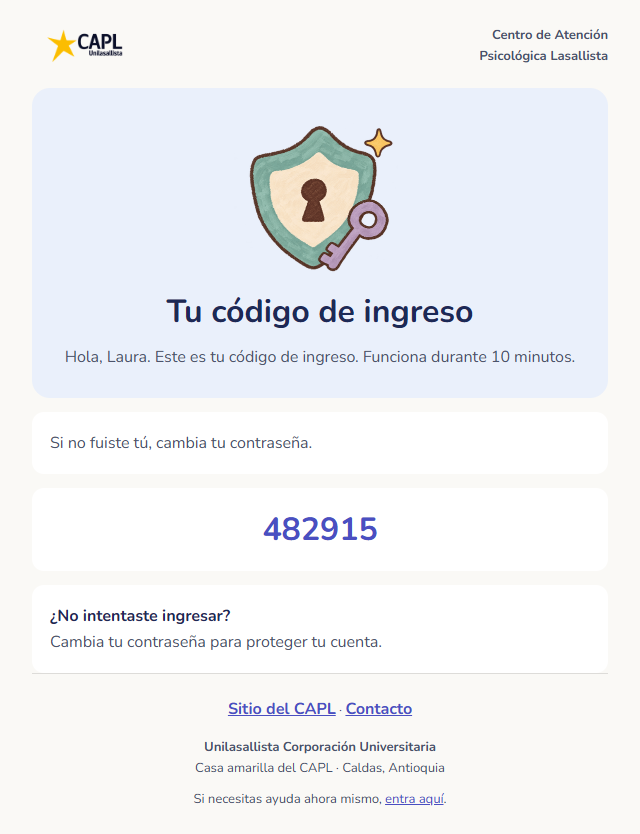
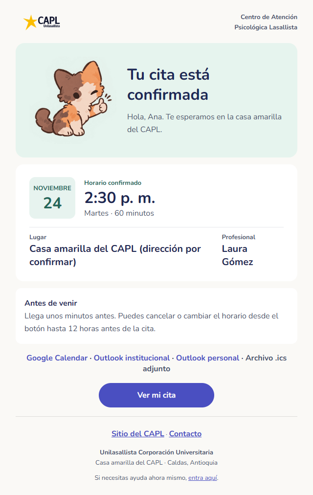
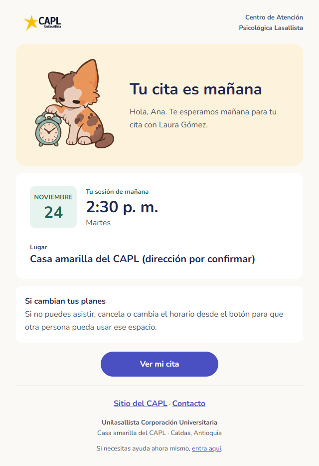

<p align="center"></p>

# CAPL

Plataforma web del **Centro de Atención Psicológica Lasallista**: permite **pedir cita en línea**, orienta ante una **emergencia emocional** y da a **administración y psicólogos** un panel para gestionar citas, horarios y eventos.

Unilasallista Corporación Universitaria (Caldas, Antioquia) · Equipo: Sebas, Brand y César, con Gemini como colaborador IA.

<p align="center"><a href="https://capl.juanlabs.me"><strong>🌐 Ver el sitio en vivo: capl.juanlabs.me</strong></a></p>

## Documentación

| Tema                                | Dónde está                                               |
| ----------------------------------- | -------------------------------------------------------- |
| Cómo usar la plataforma             | [Guía de uso](docs/guia-de-uso.md)                       |
| Qué hace cada módulo                | [Capacidades](docs/capacidades.md)                       |
| Stack, datos y estados de la cita   | [Arquitectura](docs/arquitectura.md)                     |
| Contraseñas, permisos y privacidad  | [Seguridad](docs/seguridad.md)                           |
| Código de ingreso de administración | [Segundo paso (2FA)](docs/autenticacion-2fa.md)          |
| Plantillas de correo                | [Correos](docs/correos.md)                               |
| Variables y entornos                | [Instalación y entornos](docs/instalacion-y-entornos.md) |
| Respaldos, tareas y despliegue      | [Operación](docs/operacion.md)                           |
| Comprobaciones                      | [Pruebas](docs/pruebas.md)                               |
| Marca, ilustración y Figma          | [Diseño](docs/diseno.md)                                 |
| Reparto y protocolo                 | [Equipo](docs/equipo.md)                                 |
| Requisitos y decisiones completas   | [`cerebro/`](cerebro/00-Inicio.md)                       |

## Inicio rápido

Necesitas Node 24 (`.nvmrc`) y Docker.

```bash
cp .env.example .env     # rellena AUTH_SECRET y CLAVE_CIFRADO
npm install
npm run bd:subir         # PostgreSQL local (puerto 5433)
npm run bd:migrar
npm run bd:semilla
npm run dev              # http://localhost:3000
```

Cuentas de ejemplo (contraseña `clave-de-prueba-capl`): `admin@ejemplo.test` y `psicologo1@ejemplo.test`. Cómo generar las claves y leer el código de ingreso en local: [Instalación](docs/instalacion-y-entornos.md).

| Comando                                   | Qué hace                         |
| ----------------------------------------- | -------------------------------- |
| `npm run dev`                             | Servidor de desarrollo           |
| `npm run lint` · `npm run tipos`          | Calidad y tipos                  |
| `npm run pruebas` · `npm run pruebas:e2e` | Pruebas de lógica y de navegador |
| `npm run build`                           | Compilación de producción        |
| `npm run pc:subir`                        | Todo el sitio en Docker          |

## Qué hace

| Módulo          | Funcionalidad                                                                       |
| --------------- | ----------------------------------------------------------------------------------- |
| Citas           | Cupos reales, solicitud en cinco pasos y enlace privado para cancelar o reprogramar |
| Ayuda inmediata | Orientador, líneas de ayuda y primeros auxilios emocionales                         |
| Administración  | Autorizar citas y gestionar equipo, eventos, servicios y configuración              |
| Psicología      | Perfil, horario, citas y pacientes propios                                          |
| Correo          | Avisos automáticos con reintentos                                                   |
| Seguridad       | argon2id, segundo paso para administración, límites de intentos y motivo cifrado    |

## Arquitectura

```
app/          sitio público, acceso, panel y API (Next.js)
componentes/  interfaz en niveles Atomic Design
servidor/     reglas de negocio
contratos/    validación compartida (Zod)
correos/      plantillas de correo
prisma/       modelo de datos (PostgreSQL)
infra/        Docker, respaldos y tareas
cerebro/      requisitos, especificación y normas
```

## Correos

|                                         Código de ingreso                                         |                                       Cita autorizada                                        |                                      Recordatorio                                      |
| :-----------------------------------------------------------------------------------------------: | :------------------------------------------------------------------------------------------: | :------------------------------------------------------------------------------------: |
|  |  |  |

[Ver las 18 plantillas](docs/correos.md)
