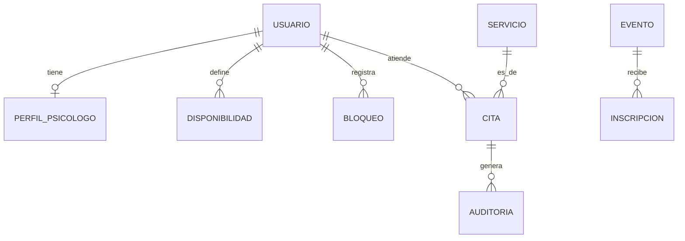
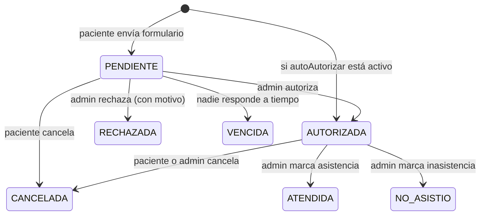
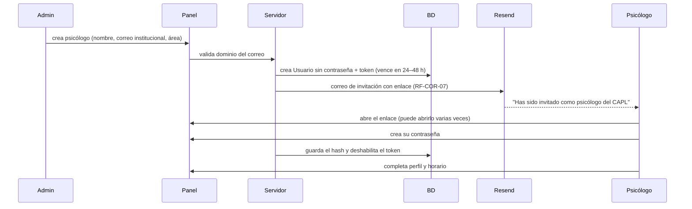

# 05 · Arquitectura

Volver a [[00-Inicio]].

> **Estado: stack confirmado** (P-07, 13-nov-2026). Criterio: lo mínimo que cumpla los requisitos, que tres personas puedan construir y que después funcione **casi sin mantenimiento**.

## Stack propuesto

| Capa | Elección | Por qué |
|------|----------|---------|
| Aplicación | **Next.js + TypeScript** (un solo proyecto: sitio público, panel y API) | Un repositorio, un lenguaje, un despliegue |
| Estilos | Tailwind CSS con los tokens exportados de Figma | El diseño pasa a código sin reinterpretar |
| Base de datos | **PostgreSQL** + Prisma (migraciones) | Restricciones de integridad para evitar doble reserva |
| Sesiones | Auth.js con credenciales (correo + contraseña) | Evita escribir autenticación a mano |
| Validación | Zod: los mismos esquemas en formulario y servidor | Es el "contrato" compartido entre los tres |
| Correo | **Resend** + plantillas React Email | Ya decidido |
| Imágenes | Carpeta en el servidor (volumen) | Sin servicios extra; pocas fotos |
| Despliegue | Docker Compose en el servidor propio + proxy con HTTPS automático (Caddy) | Reproducible con un comando |
| CI | GitHub Actions: lint, tipos, pruebas, build | Bloquea PR rotos |

**No se usa** (a propósito): microservicios, colas de mensajes, Redis, CMS, app móvil, servicio de almacenamiento externo. Se añaden solo si un requisito medido lo exige.

## Estructura del repositorio

```
/
├─ app/
│  ├─ (publico)/        ← sitio público, guía de emergencias, formulario, eventos   [A]
│  ├─ (panel)/admin/    ← panel de administración                                    [C]
│  ├─ (panel)/psicologo/← panel del psicólogo                                        [C]
│  └─ api/              ← rutas de la API                                            [B]
├─ componentes/ui/      ← sistema de diseño (botón, campo, tarjeta…)                 [A]
├─ contenido/           ← emergencias.json, servicios, FAQ, textos legales           [A]
├─ servidor/            ← lógica: cupos, citas, correo, permisos                     [B]
├─ contratos/           ← esquemas Zod y tipos compartidos                           [B, cambios por PR de cualquiera]
├─ correos/             ← plantillas de correo                                       [B código, A diseño]
├─ prisma/              ← esquema y migraciones                                      [B]
├─ infra/               ← docker-compose, proxy, copias de seguridad                 [C]
└─ cerebro/             ← esta bóveda
```

Las letras son los dueños definidos en [[06-Division-del-Trabajo]].

## Modelo de datos



| Entidad | Campos principales |
|---------|--------------------|
| `Usuario` | correo (único), nombre, rol (`ADMIN`/`PSICOLOGO`), hash de contraseña (vacío hasta que la crea), token de acceso y su vencimiento, activo |
| `PerfilPsicologo` | usuario, foto, presentación, área, servicios que atiende, visible en directorio |
| `Disponibilidad` | psicólogo, día de la semana, hora inicio, hora fin |
| `Bloqueo` | psicólogo (o vacío = todo el centro), desde, hasta, motivo |
| `Servicio` | nombre, descripción, duración en minutos, área, activo |
| `Cita` | servicio, psicólogo, inicio, fin, estado, para quién, nombre y documento del paciente, edad, datos del acudiente, correo, teléfono, motivo (opcional), consentimiento (fecha + versión), token de gestión |
| `Evento` | título, descripción, inicio, lugar/enlace, imagen, cupo, publicado |
| `Inscripcion` | evento, nombre, correo, teléfono, consentimiento |
| `Configuracion` | autoAutorizar, anticipación mínima/máxima, límite de citas activas, dominios permitidos |
| `Auditoria` | quién, qué acción, sobre qué, cuándo |

**Regla clave (RNF-DAT-01):** índice único sobre `(psicólogo, inicio)` para citas en estado `PENDIENTE` o `AUTORIZADA`. Si dos personas envían el mismo horario, la base de datos rechaza a la segunda.

## Cálculo de cupos (RF-CIT-03)

```
cupos(psicólogo, día) =
    bloques de Disponibilidad de ese día de la semana
    partidos según la duración del Servicio
  − Citas PENDIENTE o AUTORIZADA
  − Bloqueos del psicólogo y del centro (incluye festivos)
  − horarios fuera de la anticipación mínima/máxima
```

Es una función pura: se calcula al consultar, no se guardan cupos en la base de datos. Es la pieza con más pruebas automáticas.

## Estados de la cita



| Transición | Correo |
|------------|--------|
| → PENDIENTE | RF-COR-01 al paciente, RF-COR-02 a administración |
| → AUTORIZADA | RF-COR-03 al paciente, RF-COR-06 al psicólogo |
| → RECHAZADA | RF-COR-04 |
| → CANCELADA | RF-COR-05 |
| → VENCIDA | RF-COR-04 (variante "no pudimos confirmar") |

`RECHAZADA`, `VENCIDA` y `CANCELADA` **liberan** el horario.

> `VENCIDA` quedó aprobada (RF-CIT-12). **Reprogramar** (RF-CIT-13) no es un estado nuevo: en una sola operación cancela la cita actual y crea otra en el horario elegido.
>
> El detalle exacto de todo este documento está en [[E00-Especificacion-Inicio]].
>
> Seguridad, permisos, servicios externos, colas, observación y mantenimiento: [[S00-Servidor-Inicio]].
>
> Una **tarea programada cada minuto** hace, entre otras, tres cosas: vence las pendientes sin respuesta, envía los recordatorios de 24 h (RF-COR-10) y reintenta correos fallidos. Los festivos (RF-ADM-13) se calculan con una librería, sin tabla que mantener.

## Flujo: alta de psicólogo



Si el enlace vence sin usarse: el psicólogo pide otro desde la pantalla de ingreso, o el administrador lo reenvía (RF-ADM-02).

## Resiliencia con mantenimiento mínimo

Responde a RNF-REN-07 a 09 de [[03-Requisitos-No-Funcionales]]. Nada de esto añade servicios nuevos.

| Fallo | Qué pasa solo |
|-------|---------------|
| La aplicación se cuelga | El contenedor se reinicia (`restart: unless-stopped` + comprobación de salud) |
| El servidor se reinicia | Docker levanta todo al arrancar |
| La base de datos no responde | Las páginas públicas y de emergencias son **estáticas**: siguen visibles. El formulario muestra los contactos del CAPL |
| Resend falla | La cita se guarda; el correo queda pendiente y se reintenta |
| Sin conexión en el celular | La guía de emergencias se abre desde la copia instalada (RF-PUB-10) |
| Vence el certificado HTTPS | El proxy lo renueva solo |
| Se llena el disco | Rotación de registros y retención de 14 copias |
| Se pierde el servidor | Copia diaria fuera del servidor; restaurar es un comando documentado |

Un monitor externo avisa por correo al CAPL y al equipo solo si algo **no** se recuperó solo.

## Entornos

| Entorno | Dónde | Datos | Correos |
|---------|-------|-------|---------|
| Local | PC de cada integrante | de ejemplo (semilla) | no salen; se ven en consola |
| Pruebas (staging) | servidor propio, dominio de pruebas | de ejemplo | redirigidos al equipo |
| Producción | servidor propio, dominio definitivo | reales | reales |

Las variables de entorno necesarias se documentan en `.env.example` (sin valores secretos).
