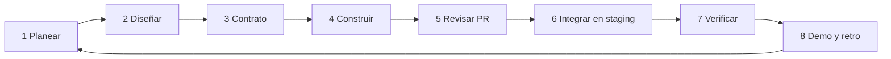

# 08 · Ruta de desarrollo

Volver a [[00-Inicio]]. De principio a fin: 7 fases (la de citas partida en dos), unas **11 semanas**. Las semanas son relativas al inicio; se ajustan a la disponibilidad real del equipo.

> Las casillas de esta nota son los **requisitos** de cada fase. Las **tareas** concretas, con responsable, dependencias y criterio de hecho, están en [[E08-Backlog]]. El plan pasó de 9 a 11 semanas al aprobarse seis propuestas y al dar a eventos, pulido y lanzamiento una semana completa cada uno.

## El bucle (se repite cada semana)

| Paso | Qué pasa | Sale |
|------|----------|------|
| 1 Planear | Se eligen los requisitos de la semana y se reparten | Issues asignados |
| 2 Diseñar | A deja las pantallas "Listas para desarrollo" | Marcos de Figma |
| 3 Contrato | Se acuerda la forma de los datos que cruzan roles | PR a `contratos/` |
| 4 Construir | Cada uno en su carpeta, en ramas cortas | Ramas |
| 5 Revisar | PR con revisión cruzada y CI | PR aprobado |
| 6 Integrar | Unión a `main` → despliegue automático | Staging actualizado |
| 7 Verificar | Otra persona prueba en staging contra el requisito | Casilla marcada |
| 8 Demo y retro | Se muestra lo hecho; qué mantener, qué cambiar | Ajustes al plan |

Reglas en [[07-Protocolo-de-Equipo]].

---

## Fase 0 — Preparación (semana 1)

**Meta:** los tres pueden programar y desplegar. Aún no hay funcionalidades.

- [x] Responder lo bloqueante de [[10-Preguntas-Abiertas]] (falta solo P-08: reparto de B y C)
- [x] Autorizar las propuestas del lanzamiento de [[09-Propuestas-por-Autorizar]] (aprobadas PR-01, 03–07, 16; descartadas PR-02, 20, 23)
- [ ] Enviar [[11-Cuestionario-CAPL]] al CAPL
- [x] Normas de diseño y de código definidas ([[N00-Normas-Inicio]])
- [ ] **A:** variables de Figma según [[N10-Tokens-y-Figma]], componentes base de [[N06-Componentes-y-Estados]], primeros mockups y mapa del sitio
- [ ] **B:** repositorio, proyecto base, esquema inicial de datos, datos de ejemplo
- [ ] **C:** servidor, dominio de pruebas con HTTPS, despliegue automático, CI
- [ ] **B+C:** dominio verificado en Resend y **correo de prueba recibido en un buzón institucional** (RG-02)
- [ ] Protección de `main`, plantilla de PR, tablero de issues

**Se cierra cuando:** una página "Hola CAPL" se despliega sola en staging al unir un PR, y un correo de prueba llega.

## Fase 1 — Sitio público y emergencias (semanas 2–3)

**Meta:** el sitio ya informa y orienta, aunque todavía no agende.

- [ ] RF-PUB-01 Inicio
- [ ] RF-PUB-02 Cómo funciona
- [ ] RF-PUB-03 Servicios
- [ ] RF-PUB-04 Preguntas frecuentes
- [ ] RF-PUB-05 Contacto
- [ ] RF-PUB-06 Redes sociales
- [ ] RF-PUB-08 Aviso "no somos urgencias"
- [ ] RF-PUB-09 Política de datos
- [ ] RF-EMG-01 Códigos de emergencia
- [ ] RF-EMG-02 Líneas de ayuda
- [ ] RF-EMG-04 Botón "Necesito ayuda ahora"
- [ ] RF-EMG-05 Contenido en un solo archivo (`contenido/emergencias.json`)
- [ ] RF-EMG-03 Orientador interactivo "¿Qué me está pasando?"
- [ ] RF-EMG-06 Recursos de primeros auxilios emocionales (ejercicio de anclaje 5-4-3-2-1)
- [ ] Contenido de emergencias **aprobado por el CAPL**
- [ ] *En paralelo:* A diseña paneles; B adelanta cuentas; C adelanta estructura del panel

**Se cierra cuando:** el CAPL revisa el sitio en staging y aprueba los textos.

## Fase 2 — Cuentas, psicólogos y horarios (semanas 4–5)

**Meta:** el administrador crea psicólogos y cada uno deja listo su perfil y horario.

- [ ] RF-AUT-01 Inicio de sesión
- [ ] RF-AUT-05 Roles
- [ ] RF-AUT-06 Solo correo institucional
- [ ] RF-ADM-01 Crear psicólogo
- [ ] RF-AUT-02 Cuenta sin contraseña + enlace
- [ ] RF-COR-07 Correo de invitación
- [ ] RF-AUT-03 Enlace de 24–48 h que se deshabilita al crear la contraseña
- [ ] RF-AUT-04 / RF-COR-08 Recuperar contraseña
- [ ] RF-AUT-07 Cierre y expiración de sesión
- [ ] RF-ADM-02 Listar, editar, desactivar psicólogos
- [ ] RF-PSI-01 Perfil con foto
- [ ] RF-PSI-02 Horario semanal
- [ ] RF-PSI-06 Cambiar contraseña
- [ ] RF-PSI-03 Bloqueos puntuales *(D)*
- [ ] RF-PSI-07 / RF-PUB-07 Directorio público *(D)*
- [ ] RF-ADM-11 Otros administradores *(D)*
- [ ] *En paralelo:* A diseña el formulario de cita y los correos

**Se cierra cuando:** de principio a fin en staging: crear psicólogo → llega el correo → abre el enlace → crea su clave → carga perfil y horario; y el enlace ya no sirve.

## Fase 3 — Citas (semanas 6–8) · *el corazón del proyecto*

Se trabaja en dos partes: **3a, núcleo** (semanas 6–7: pedir, autorizar, rechazar, cancelar) y **3b, acompañamiento** (semana 8: vencimiento, recordatorio, calendario, reprogramar, exportar).

**Meta:** una persona pide cita y recibe sus correos; administración autoriza.

- [ ] Contrato `contratos/cita.ts` acordado
- [ ] RF-CIT-03 Cálculo de cupos (con pruebas)
- [ ] RF-CIT-05 Sin doble reserva (con prueba de simultaneidad)
- [ ] RF-CIT-01 Formulario por pasos
- [ ] RF-CIT-02 Para mí / otra persona / menor
- [ ] RF-CIT-06 Datos mínimos
- [ ] RF-CIT-07 Consentimiento
- [ ] RF-CIT-08 Cita pendiente y pantalla de confirmación
- [ ] RF-CIT-09 Anticipación mínima y máxima
- [ ] RF-COR-01 "En proceso de autorización"
- [ ] RF-COR-02 Aviso a administración
- [ ] RF-ADM-03 Bandeja de citas
- [ ] RF-ADM-04 Autorizar / rechazar
- [ ] RF-COR-03 "Tu cita ha sido autorizada"
- [ ] RF-COR-04 Cita no autorizada
- [ ] RF-COR-06 Aviso al psicólogo
- [ ] RF-ADM-06 Auto-autorización
- [ ] RF-ADM-09 Bloqueo de fechas del centro
- [ ] RF-ADM-12 Registro de acciones
- [ ] RF-CIT-11 / RF-COR-05 Cancelar por enlace
- [ ] RF-CIT-12 Vencimiento de solicitudes sin respuesta
- [ ] RF-CIT-13 Reprogramar desde el correo
- [ ] RF-COR-10 Recordatorio 24 h antes
- [ ] RF-COR-11 Cita al calendario (`.ics`)
- [ ] RF-ADM-13 Festivos de Colombia automáticos
- [ ] RF-ADM-14 Exportar citas a CSV
- [ ] RF-PSI-04 Mis citas
- [ ] RF-PSI-05 Datos solo de mis citas
- [ ] *(D)* RF-CIT-04, RF-CIT-10, RF-ADM-05, RF-ADM-07, RF-ADM-08, RF-ADM-10

**Se cierra cuando:** una persona ajena al equipo pide una cita en staging desde su celular, recibe los dos correos, y un administrador de prueba la autoriza sin ayuda.

## Fase 4 — Eventos (semana 9)

- [ ] RF-EVE-01 Gestión de eventos
- [ ] RF-EVE-02 Eventos públicos
- [ ] RF-EVE-03 Inscripción
- [ ] RF-COR-09 Correo de inscripción
- [ ] RF-EVE-06 Ocultar eventos pasados
- [ ] RF-EVE-04 Cupo *(D)*
- [ ] RF-EVE-05 Lista de inscritos y CSV *(D)*

**Se cierra cuando:** se crea un evento, alguien se inscribe y recibe la información.

## Fase 5 — Pulido y endurecimiento (semana 10)

- [ ] Auditoría de accesibilidad (RNF-ACC-01) y recorrido solo con teclado
- [ ] Prueba con 3 personas reales pidiendo cita (RNF-ACC-04)
- [ ] Revisión de seguridad: permisos, límites de intentos, tokens (RNF-SEG-\*)
- [ ] Rendimiento móvil (RNF-REN-01)
- [ ] Copias de seguridad y **simulacro de restauración** (RNF-REN-04)
- [ ] **Simulacro de caídas:** matar la app, apagar la BD, reiniciar el servidor (RNF-REN-07, 08)
- [x] ~~RF-PUB-10 Sitio instalable y emergencias sin conexión~~ *(Descartado para MVP/Final)*
- [ ] Prueba de desbordes de 320 a 1920 px y zoom 200 % (RNF-ACC-07)
- [ ] Entrega de correo comprobada en Gmail, Outlook e institucional (RNF-COR-\*)
- [ ] Textos finales y política de datos aprobados por el CAPL / universidad
- [ ] Propuestas autorizadas que quepan

**Se cierra cuando:** no quedan errores graves abiertos y todas las verificaciones de [[03-Requisitos-No-Funcionales]] pasan.

## Fase 6 — Lanzamiento y entrega (semana 11)

- [ ] Autorización institucional de nombre y logo (RES-LEG-07)
- [ ] Dominio definitivo, HTTPS y Resend en producción
- [ ] Base de datos de producción limpia + primer administrador
- [ ] Carga de psicólogos reales y sus horarios
- [ ] Prueba completa en producción con una cita real de prueba
- [ ] Monitor de caídas activo (RNF-REN-06)
- [ ] Manual de administración (RNF-MAN-05)
- [ ] Capacitación a monitoras y psicólogos
- [ ] Etiqueta `v1.0`
- [ ] Cambiar el enlace del sitio anterior para que apunte al nuevo

**Se cierra cuando:** el CAPL agenda su primera cita real sin intervención del equipo.

## Después del lanzamiento

- Dos semanas de acompañamiento: corregir lo que aparezca con uso real.
- Revisar qué propuestas `O` de [[09-Propuestas-por-Autorizar]] valen la pena con datos reales.
- Traspaso: quién mantiene el servidor y quién actualiza el contenido cada semestre.

## Vista general

| Semana | 1 | 2 | 3 | 4 | 5 | 6 | 7 | 8 | 9 | 10 | 11 |
|--------|---|---|---|---|---|---|---|---|---|----|----|
| Fase | 0 | 1 | 1 | 2 | 2 | 3a | 3a | 3b | 4 | 5 | 6 |
| A diseña | base | paneles | paneles | cita + correos | cita + correos | eventos | ajustes | — | — | — | — |
| A construye | componentes | público | emergencias | acceso | directorio | formulario | mi cita | reprogramar | eventos | accesibilidad | revisión |
| B | base + correo | contratos | contratos | cuentas | perfil + horario | cupos + crear | estados + correos | tareas + reprogramar | inscripción | seguridad | producción |
| C | infra + CI | panel base | panel base | psicólogos | perfil + horario | bandeja | autorización | exportar | eventos | copias + caídas | despliegue + manual |
