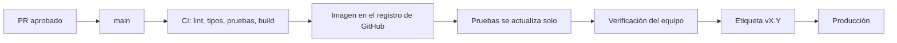

# E07 · Infraestructura

Volver a [[E00-Especificacion-Inicio]]. Dueño: rol C. Cumple RNF-REN-04 y RNF-REN-06 a 09 de [[03-Requisitos-No-Funcionales]]: se recupera solo y no requiere tareas manuales.

**Supuesto:** servidor Linux (Debian o Ubuntu) con acceso SSH.

> ⚡ **Estrategia por fases (14-nov-2026):**
> 1. **Fase 1 (Desarrollo y MVP inicial):** Se trabaja directamente en **Node.js local sin Docker** para iterar con máxima velocidad, evitando imágenes pesadas de Node y dependencias innecesarias.
> 2. **Fase 2 (Producción final):** Una vez que todo esté probado y funcionando al 100%, se empaqueta en Docker con un `Dockerfile` multi-stage ultraligero (`node:lts-alpine`) que solo incluye los archivos compilados indispensables.

## Servicios (Docker Compose)

| Servicio | Imagen | Hace | Reinicio | Comprobación de salud |
|----------|--------|------|----------|-----------------------|
| `proxy` | Caddy | HTTPS automático, redirige HTTP, comprime, sirve los archivos subidos | siempre | — |
| `app` | La del proyecto | Aplicación Next.js | siempre | `GET /api/salud` cada 30 s |
| `db` | PostgreSQL | Base de datos | siempre | `pg_isready` |
| `tareas` | Imagen mínima con `curl` | Llama a `POST /api/tareas` cada minuto | siempre | — |
| `respaldo` | Imagen de PostgreSQL | Copia diaria de la base de datos | siempre | — |

> **Nota de alcance (13-nov-2026):** Se retiraron los servicios de `alloy`, `loki` y `grafana` para aligerar el despliegue del MVP (20-nov) y la entrega final (28-nov). El monitoreo se cubre con `GET /api/salud`, healthcheck de Docker, logs por consola en JSON y un monitor externo ligero.

Volúmenes: `datos_db` (base de datos) · `archivos` (fotos e imágenes) · `respaldos` · `caddy_datos` (certificados).

Reglas:

- Solo `proxy` publica puertos (80 y 443). La base de datos **no** es accesible desde fuera.
- `app` espera a que `db` esté sana y aplica las migraciones pendientes al arrancar.
- `restart: unless-stopped` en todos: tras un reinicio del servidor, todo vuelve solo.
- Registros con rotación (10 MB × 3 archivos por servicio).
- Límites de memoria por servicio para que uno no tumbe a los demás.

## Dos entornos, un servidor

| | Pruebas | Producción |
|---|---------|------------|
| Carpeta | `/srv/capl-pruebas` | `/srv/capl` |
| Dominio | Dominio propio de pruebas | Subdominio oficial (P-19) |
| Base de datos | Propia, con datos de ejemplo | Propia, con datos reales |
| Correos | Desviados al equipo | Reales |
| Se despliega | En cada unión a `main` | A mano, por etiqueta |
| Buscadores | Bloqueado (`noindex` en todo) | Abierto en el sitio público |

Cada entorno es un proyecto de Compose independiente, con su propio `.env`. El `proxy` es uno solo y atiende ambos dominios.

## Despliegue

| Paso | Detalle |
|------|---------|
| CI en cada PR | `lint`, `tipos`, `pruebas`, `build`. Si algo falla, no se puede unir |
| Al unir a `main` | Se construye la imagen, se etiqueta con el identificador del commit y se publica en el registro de contenedores de GitHub |
| Pruebas | El flujo entra por SSH con una llave de solo despliegue y ejecuta `docker compose pull` y `up -d` |
| Producción | Mismo flujo, disparado al crear una etiqueta `v*`; **antes** ejecuta una copia de seguridad |
| Vuelta atrás | Volver a desplegar la etiqueta anterior. Las migraciones se escriben compatibles hacia atrás: primero añadir, después quitar |
| Secretos | En los secretos de GitHub (llave SSH) y en el `.env` del servidor (todo lo demás). Nunca en el repositorio |

## Copias de seguridad

| Qué | Cómo | Cuándo | Retención |
|-----|------|--------|-----------|
| Base de datos | `pg_dump` comprimido al volumen `respaldos` | Diario, 2:00 a. m. | 14 días |
| Archivos subidos | Copia del volumen `archivos` | Diario | 14 días |
| **Copia externa** | Sincronización de `respaldos` a un destino fuera del servidor, **cifrada** | Diario, tras la copia local | 30 días |
| Antes de desplegar a producción | Copia adicional | En cada despliegue | 5 últimas |

El destino externo está por definir (P-21): otro servidor del equipo, o almacenamiento institucional. Sin copia externa **no se lanza**.

**Restaurar** es un solo comando documentado en `infra/README.md`, y se prueba en la fase 5 restaurando sobre el entorno de pruebas.

## Recuperación automática

| Fallo | Respuesta | Verificación (fase 5) |
|-------|-----------|-----------------------|
| La aplicación se cuelga | La comprobación de salud falla y Docker la reinicia | Matar el proceso → vuelve en menos de 1 min |
| Reinicio del servidor | Docker arranca con el sistema y levanta todo | Reiniciar → sitio arriba en menos de 2 min |
| Base de datos caída | Páginas `E` y `R` de [[E04-Pantallas-y-Rutas]] siguen visibles; el formulario muestra los contactos del CAPL | Detener `db` y recorrer el sitio |
| Resend no responde | El correo queda en cola y se reintenta | Clave inválida en pruebas → la cita se crea igual |
| Certificado por vencer | Caddy lo renueva | — |
| Disco | Rotación de registros y retención de copias; alerta al 80 % | — |
| Vulnerabilidades del sistema | Actualizaciones de seguridad automáticas del sistema operativo | Revisar que están activas |
| Dependencias | Avisos automáticos de GitHub; se atienden las de seguridad | — |

## Monitoreo

- **Monitor externo** gratuito que consulta `/api/salud` cada 5 minutos y avisa por correo al equipo y al CAPL si falla dos veces seguidas.
- `/api/salud` responde en error si la base de datos no contesta.
- La tarea programada informa en su respuesta cuántos correos quedaron en `FALLIDO`; si hay alguno, el panel de administración lo muestra como aviso.
- No se instala ninguna plataforma de métricas.

## Seguridad del servidor

| Medida | Valor |
|--------|-------|
| SSH | Solo con llave; sin contraseña; sin acceso directo de administrador |
| Cortafuegos | Abiertos solo 22, 80 y 443 |
| Usuario de despliegue | Sin privilegios; solo puede operar Docker en las carpetas del proyecto |
| Cabeceras | HSTS, sin detección de tipo, política de referencia estricta, política de contenido que solo permite recursos propios |
| Archivos subidos | Se sirven con tipo fijo de imagen y sin ejecución |
| `.env` del servidor | Permisos de lectura solo para el usuario de despliegue |

## Entregables de `infra/`

| Archivo | Contenido |
|---------|-----------|
| `compose.yml` | Los cinco servicios |
| `compose.dev.yml` | Solo PostgreSQL, para desarrollo local |
| `Caddyfile` | Dominios, cabeceras, compresión |
| `Dockerfile` | Imagen de la aplicación, en dos etapas |
| `respaldo.sh` | Copia, retención y sincronización externa |
| `restaurar.sh` | Restauración desde una copia |
| `README.md` | Cómo desplegar, restaurar y volver atrás; qué hacer si llega una alerta |

## Manual para el CAPL (fase 6)

Una página, sin tecnicismos: qué hacer si el sitio no abre (esperar 5 minutos; si sigue, a quién escribir), cómo saber si los correos están saliendo, y los contactos del equipo. El sistema está pensado para que esa página casi nunca se use.
