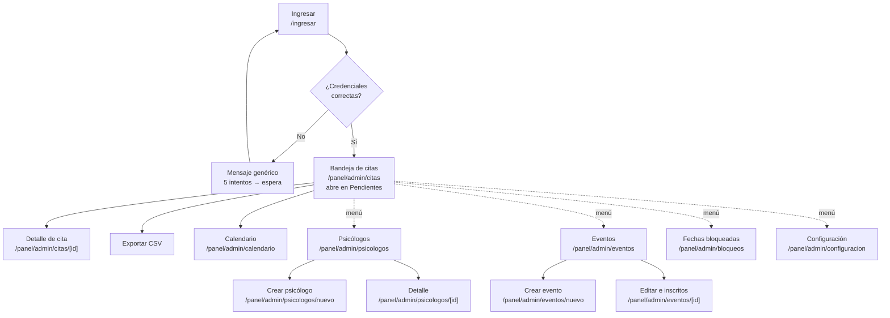
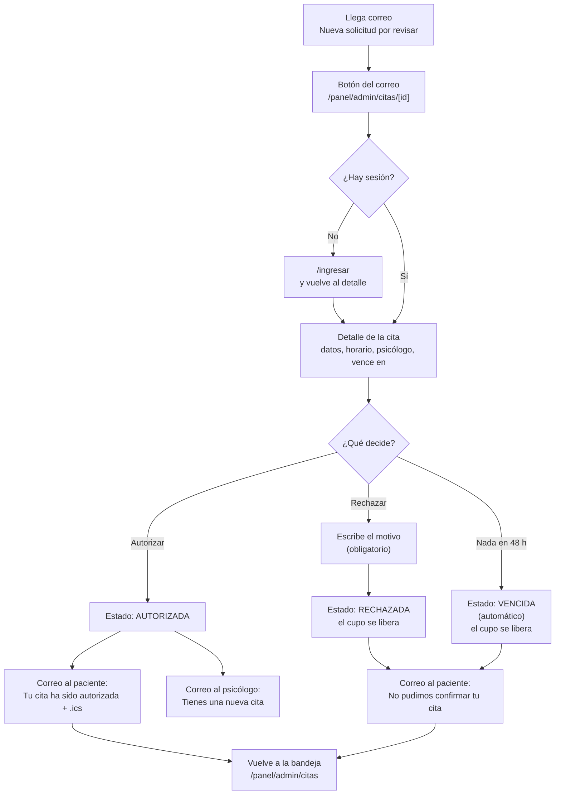
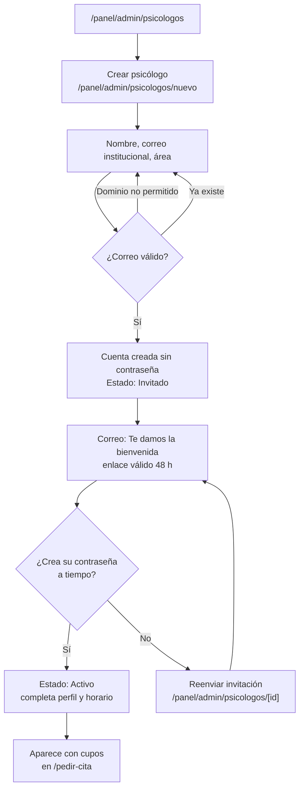
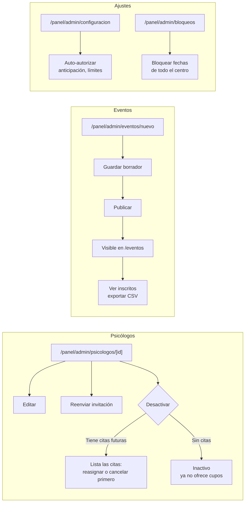
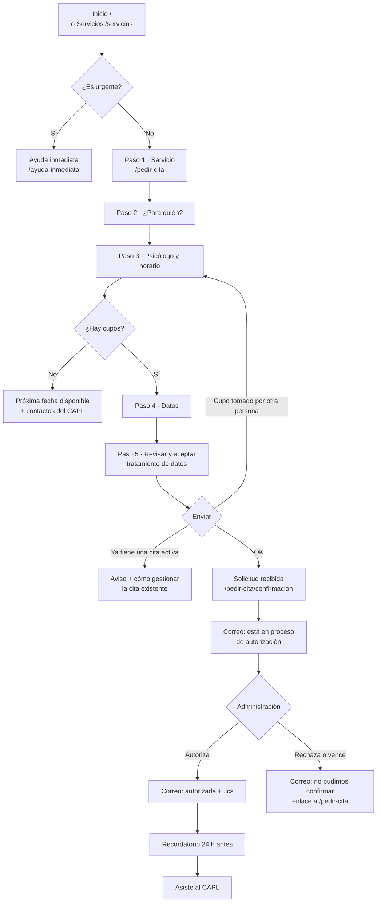
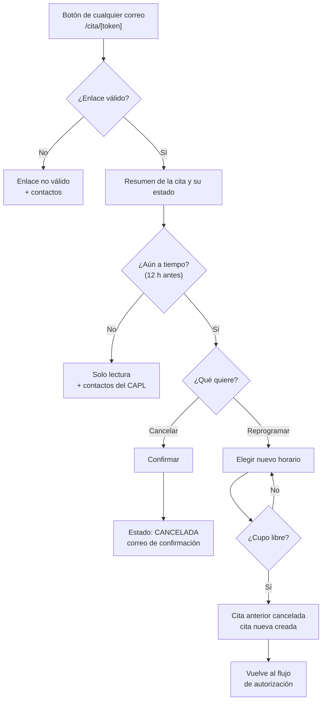
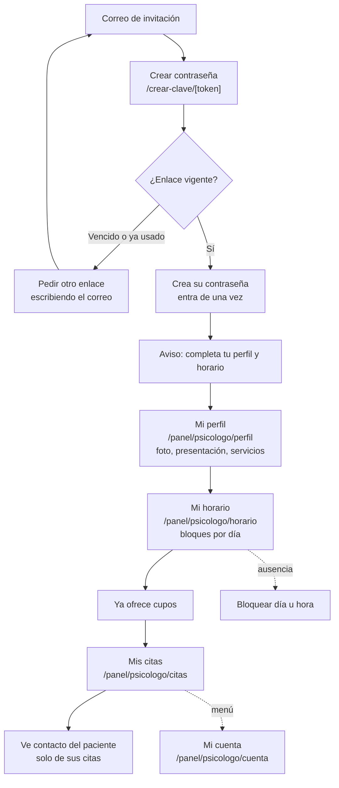
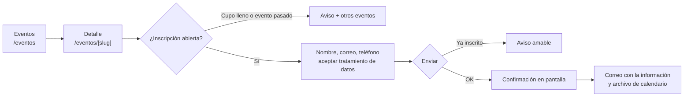
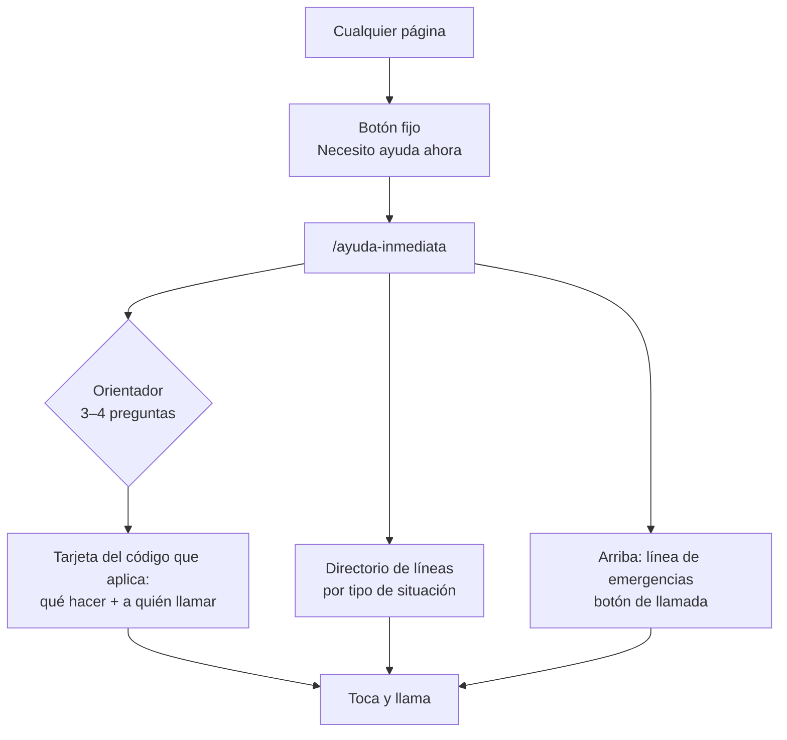

# E09 · Flujos de usuario

Volver a [[E00-Especificacion-Inicio]]. Cómo **debe** recorrer el sistema cada tipo de persona, con la ruta de cada paso. Rutas definidas en [[E04-Pantallas-y-Rutas]]; reglas en [[E03-Reglas-de-Negocio]].

## Enlaces de prueba

`{PRUEBAS}` es el dominio del entorno de pruebas (se fija en la tarea T-004). Cada ruta de esta nota se abre como `{PRUEBAS}` + ruta:

```
https://{PRUEBAS}/panel/admin/citas
```

Cuando el dominio exista, se reemplaza `{PRUEBAS}` en esta nota una sola vez y todos los enlaces quedan listos para tocar. Las cuentas de prueba (un administrador y cuatro psicólogos) las crea la semilla de [[E02-Modelo-de-Datos]]; sus claves están en el `README` del repositorio, nunca aquí.

---

## 1. Administrador

### Mapa general



### 1a. Autorizar una cita *(el flujo de todos los días)*



| Paso | Ruta | Qué ve | Qué puede salir mal |
|------|------|--------|---------------------|
| 1 | Correo | Código, servicio, horario; sin datos del paciente | — |
| 2 | `/panel/admin/citas/[id]` | Todos los datos e historial | Sin sesión → pasa por `/ingresar` y regresa aquí |
| 3 | Mismo | Botones Autorizar y Rechazar | Otra persona ya la gestionó → aviso y se recarga |
| 4 | Mismo | Confirmación en pantalla; el estado cambia | La hora ya pasó → no deja autorizar |
| 5 | `/panel/admin/citas` | La cita ya no está en Pendientes | — |

Si **auto-autorización** está activa, este flujo no ocurre: la cita nace autorizada y administración solo recibe el aviso.

### 1b. Crear un psicólogo



Un psicólogo solo ofrece cupos cuando está **activo**, tiene **servicios** marcados y tiene **horario** cargado. La lista muestra a quién le falta algo.

### 1c. Gestionar psicólogos, eventos y ajustes



### Recorrido de prueba del administrador

Se sigue en orden en el entorno de pruebas al cerrar la fase 3a. Cada casilla es una verificación.

| # | Abrir | Hacer | Debe pasar |
|---|-------|-------|------------|
| 1 | `{PRUEBAS}/ingresar` | Entrar con el administrador de prueba | Llega a `/panel/admin/citas` en "Pendientes" |
| 2 | `{PRUEBAS}/panel/admin/psicologos/nuevo` | Crear un psicólogo con un correo del equipo | Aparece como "Invitado"; llega el correo |
| 3 | Enlace del correo | Crear la contraseña | Entra al panel del psicólogo; el enlace deja de servir |
| 4 | `{PRUEBAS}/panel/psicologo/perfil` y `/horario` | Cargar foto, servicios y horario | Guardado |
| 5 | `{PRUEBAS}/pedir-cita` (ventana privada) | Pedir una cita con ese psicólogo | Pantalla de confirmación; llegan dos correos |
| 6 | `{PRUEBAS}/panel/admin/citas` | Abrir la solicitud nueva | Se ven todos los datos |
| 7 | `{PRUEBAS}/panel/admin/citas/[id]` | Autorizar | Estado "Autorizada"; correos al paciente y al psicólogo |
| 8 | `{PRUEBAS}/pedir-cita` | Pedir otra y **rechazarla** con motivo | Correo con el motivo; el cupo vuelve a estar libre |
| 9 | `{PRUEBAS}/panel/admin/configuracion` | Activar auto-autorización y pedir otra cita | Nace autorizada |
| 10 | `{PRUEBAS}/panel/admin/bloqueos` | Bloquear un día | Ese día no ofrece cupos en `/pedir-cita` |
| 11 | `{PRUEBAS}/panel/admin/psicologos/[id]` | Intentar desactivar al psicólogo con citas | No deja; lista las citas |
| 12 | `{PRUEBAS}/panel/psicologo/citas` (con el psicólogo) | Abrir `/panel/admin/citas` | Recibe "sin permiso" |

---

## 2. Persona que pide una cita



En todos los pasos está visible el botón "Necesito ayuda ahora" y se puede volver atrás sin perder lo escrito.

### Gestionar la cita desde el correo



### Recorrido de prueba de la persona

| # | Abrir | Hacer | Debe pasar |
|---|-------|-------|------------|
| 1 | `{PRUEBAS}/` desde un celular | Tocar "Pedir mi cita" | Llega al paso 1 |
| 2 | `{PRUEBAS}/pedir-cita` | Completar los 5 pasos | Menos de 3 minutos; confirmación con código |
| 3 | Mismo, paso 4 | Volver atrás y recargar la página | No se pierde lo escrito |
| 4 | Mismo | Pedir una segunda cita con el mismo correo | Aviso de que ya tiene una activa |
| 5 | Correo recibido | Abrir "Ver mi solicitud" | Resumen sin datos sensibles |
| 6 | `{PRUEBAS}/cita/[token]` | Reprogramar | Nueva cita; la anterior queda cancelada |
| 7 | Mismo | Cancelar | Estado cancelada; el cupo queda libre |
| 8 | Mismo, cambiando una letra del enlace | — | "Enlace no válido" |
| 9 | `{PRUEBAS}/ayuda-inmediata` en modo avión | — | Abre (tras la fase 5) |

---

## 3. Psicólogo en formación



Los ingresos siguientes entran por `/ingresar` y llegan directo a `/panel/psicologo/citas`. Si olvidó la contraseña: `/recuperar-clave`.

---

## 4. Persona que se inscribe a un evento



---

## 5. Persona que necesita ayuda inmediata



Este flujo no pide ningún dato, no requiere conexión tras la primera visita y **nunca** termina en un formulario.

---

## Reglas comunes a todos los flujos

| Regla | Detalle |
|-------|---------|
| Regresar | Todo paso permite volver sin perder datos |
| Sesión vencida | Lleva a `/ingresar` y devuelve a la página que se intentaba abrir |
| Sin permiso | Mensaje claro y enlace al inicio del panel propio |
| Error del sistema | Mensaje humano, botón de reintentar y contactos del CAPL |
| Fin de flujo | Siempre dice qué pasa después y cuándo |
