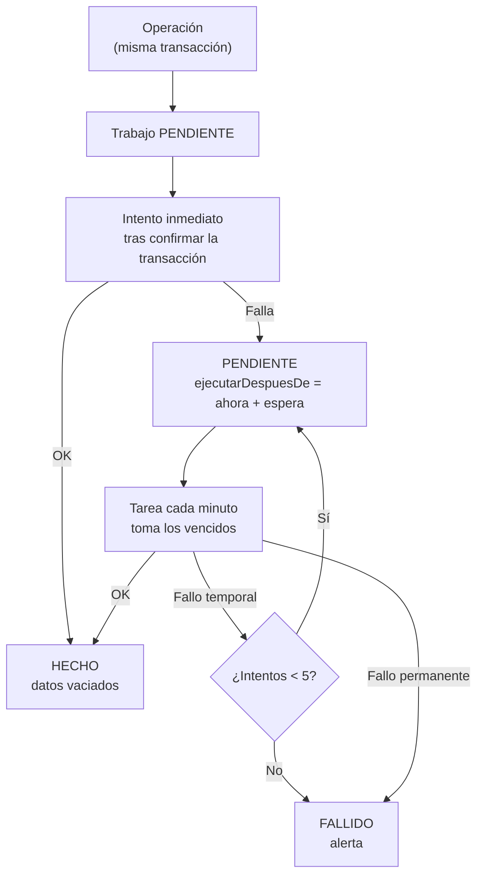

# S05 · Colas y tareas

Volver a [[S00-Servidor-Inicio]]. Cómo se maneja todo lo que **no** ocurre en el instante en que la persona pulsa un botón.

## Por qué una cola

La persona no debe esperar ni depender de que Resend o Google respondan. Al pedir una cita, el servidor guarda la cita y **anota** lo que falta por hacer; otra pieza lo ejecuta después, con reintentos.

## Diseño

**La cola es una tabla de PostgreSQL** (`Trabajo`), no un servicio aparte. Para el volumen del CAPL es suficiente, no añade nada que mantener, y permite encolar **en la misma transacción** que el cambio que lo origina: si la cita se guarda, su correo queda anotado con certeza; si la cita falla, no queda ningún correo huérfano.

Techo conocido: sirve hasta algunos miles de trabajos por hora. Si algún día no alcanza, se cambia por un sistema de colas dedicado sin tocar el resto del código, porque todo pasa por `encolar()`.

### La tabla `Trabajo`

| Campo | Significado |
|-------|-------------|
| `tipo` | Qué hay que hacer (lista abajo) |
| `datos` | Lo necesario para hacerlo; se vacía al terminar |
| `llave` | Única por trabajo lógico; impide encolar dos veces lo mismo |
| `estado` | `PENDIENTE` · `EN_CURSO` · `HECHO` · `FALLIDO` |
| `intentos` | Cuántas veces se ha intentado |
| `ejecutarDespuesDe` | No antes de este momento (reintentos y envíos diferidos) |
| `tomadoEn` | Cuándo lo tomó un proceso; sirve para rescatar trabajos colgados |
| `ultimoError` | Código del último fallo, sin datos personales |
| `citaId` | Opcional; permite mostrar en el panel los correos de una cita |

### Tipos de trabajo

| Tipo | Lo encola | Llave |
|------|-----------|-------|
| `CORREO` | Cualquier operación que avisa a alguien | `correo:{plantilla}:{entidad}:{versión}` |
| `CALENDARIO_PUBLICAR` | Cita autorizada o movida | `cal:{citaId}:{actualizadaEn}` |
| `CALENDARIO_BORRAR` | Cita cancelada o reprogramada | `calborrar:{citaId}` |
| `WEBHOOK_RESEND` | Aviso de entrega recibido | Identificador del aviso |

## Protocolo de ejecución

| Regla | Detalle |
|-------|---------|
| Tomar un trabajo | Con bloqueo de fila que salta los ya tomados; dos procesos nunca ejecutan el mismo |
| Lote | Hasta 20 trabajos por vuelta; si quedan más, la siguiente vuelta sigue |
| Orden | Por `ejecutarDespuesDe`; los correos de acceso y de cita van antes que los avisos internos |
| Esperas | 1 min, 5 min, 30 min, 2 h, 12 h |
| Rescate | Un trabajo `EN_CURSO` hace más de 5 minutos vuelve a `PENDIENTE` (el proceso murió a mitad) |
| Corte por servicio | Si un servicio está en corte ([[S04-Servicios-Externos]] regla 8), sus trabajos no se toman hasta que pase |
| Al terminar | `datos` se vacía; la fila se borra a los 30 días |
| `FALLIDO` | No se reintenta solo. Aparece en el panel y dispara alerta. Un administrador puede "reintentar" desde el detalle de la cita |

### Idempotencia

Todo trabajo debe poder ejecutarse **dos veces sin causar daño**, porque un proceso puede morir justo después de enviar y antes de marcar `HECHO`.

- Correo: la llave del trabajo viaja a Resend como llave de idempotencia.
- Calendario: el identificador del evento se deriva de la cita; publicar dos veces actualiza el mismo evento.
- Avisos de entrega: se guarda el identificador del aviso; uno repetido se descarta.

## La tarea programada

El servicio `tareas` llama a `POST /api/tareas` **cada minuto** con `CRON_SECRET`. Si una vuelta sigue en curso, la siguiente no arranca (candado en la base de datos).

| # | Paso | Frecuencia | Detalle |
|---|------|-----------|---------|
| 1 | Procesar la cola | Cada minuto | Lo descrito arriba |
| 2 | Rescatar trabajos colgados | Cada minuto | — |
| 3 | Vencer solicitudes | Cada minuto | Citas `PENDIENTE` con `venceEn ≤ ahora` |
| 4 | Recordatorios | Cada 15 min | Citas autorizadas que empiezan en 23–25 horas |
| 5 | Reconciliar calendario | Diario, 3:00 a. m. | [[S04-Servicios-Externos]] |
| 6 | Anonimizar | Diario | Citas más antiguas que el plazo de conservación |
| 7 | Limpiar | Diario | Tokens vencidos, trabajos terminados, códigos usados, dispositivos de confianza vencidos |
| 8 | Latido | Cada minuto | Escribe en el registro "tarea viva" con cuántos trabajos hay pendientes y fallidos |

Reglas:

- Cada paso es **idempotente** y está aislado: si uno falla, los demás corren.
- Cada paso tiene un límite de tiempo de 30 segundos.
- La tarea devuelve un resumen (cuántos enviados, vencidos, recordados, fallidos) que va al registro.
- Si el latido falta durante 5 minutos, [[S06-Observabilidad]] alerta: es la señal de que la cola está parada.

## Concurrencia en las citas

La "fila" de personas pidiendo el mismo horario no se resuelve con una cola, sino con la base de datos:

| Situación | Cómo se resuelve |
|-----------|------------------|
| Dos personas piden el mismo cupo a la vez | La restricción de exclusión acepta a la primera; la segunda recibe `CUPO_OCUPADO` y elige otro horario |
| Dos inscripciones al último cupo de un evento | La comprobación y la inserción ocurren en una sentencia con bloqueo; una recibe `CUPO_LLENO` |
| Dos administradores gestionan la misma cita | El cambio de estado exige que el estado siga siendo el esperado; el segundo recibe `TRANSICION_INVALIDA` y ve el estado nuevo |
| Reprogramar mientras administración cancela | Igual: gana el primero; el otro ve la cita actualizada |

No hay lista de espera: sigue como propuesta sin aprobar (PR-09).

## Qué ve el administrador

- En el detalle de cada cita: los correos asociados y su estado (enviado, pendiente, no entregado).
- En el inicio del panel: un aviso si hay trabajos `FALLIDO`, con enlace a la lista.
- Botón "Reintentar" por trabajo fallido.

No ve la cola completa ni detalles técnicos; eso está en Grafana para quien opera.
