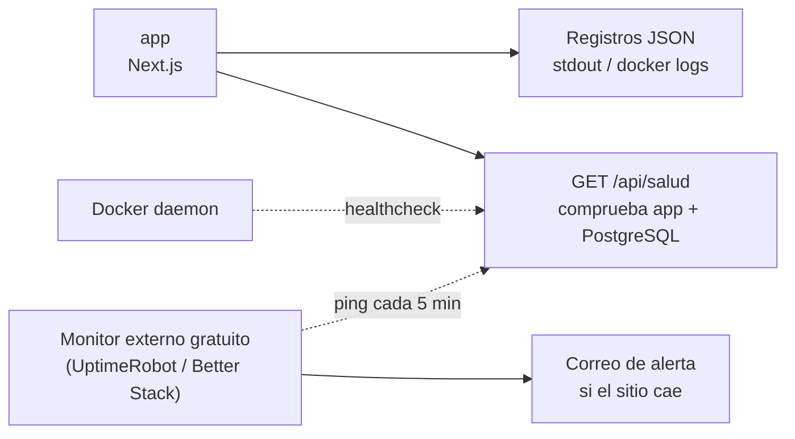

# S06 · Observabilidad

Volver a [[S00-Servidor-Inicio]]. Medidas básicas de monitoreo y registros tras descartar la pila pesada (Loki + Grafana + Alloy) para la entrega del 20-nov (MVP) y 28-nov (final).

## Medidas básicas conservadas

| Medida | Qué hace | Cómo funciona |
|---|---|---|
| **Ruta de salud** (`/api/salud`) | Verifica que la aplicación y la BD responden | Responde HTTP 200 `{"estado": "ok"}` o 503 si la BD no conecta |
| **Healthcheck Docker** | Auto-recuperación local | Docker vigila `/api/salud` y reinicia el contenedor automáticamente si se cuelga |
| **Registros estructurados** | Diagnóstico rápido sin servidores extra | La función `registrar()` escribe una línea JSON en consola (`stdout`). Se consultan con `docker compose logs app` |
| **Monitor externo con alerta al correo** | Alerta inmediata de caída total | Servicio externo de vigilancia (UptimeRobot / Better Stack) consulta `GET /api/salud` cada 3 a 5 min. Si la app o PostgreSQL caen o tardan más de 5 s en responder, **te envía de inmediato una alerta a tu correo electrónico** (y otro aviso cuando se restablezca). |

> **Decisión 13-nov-2026:** Se retiran Grafana, Loki y Alloy del Docker Compose para evitar retrasos de configuración y ahorrar ≈ 1 GB de RAM. Si en el futuro se requieren tableros visuales, se instalarán después de la entrega final.

## Formato de los registros

Una línea JSON por evento, escrita por una única función `registrar()`.

| Campo | Ejemplo | Nota |
|-------|---------|------|
| `t` | fecha y hora UTC | — |
| `nivel` | `info` · `aviso` · `error` | — |
| `evento` | `cita.creada` | Del catálogo de abajo |
| `peticion` | identificador aleatorio | El mismo en todas las líneas de una petición; también se devuelve en una cabecera para poder rastrear un reporte |
| `ruta` | `/pedir-cita` | Sin identificadores ni tokens: `/cita/[token]` |
| `rol` | `publico` · `psicologo` · `admin` · `sistema` | — |
| `actor` | identificador del usuario | Solo para personal; nunca para el público |
| `entidad` | `cita:ckx…` | Identificador interno, nunca el código legible ni un nombre |
| `ms` | 84 | Duración |
| `resultado` | `ok` o un código de error | Los de [[E05-Operaciones-y-Contratos]] |

### Lo que jamás aparece en un registro

Nombres, documentos, correos o teléfonos de pacientes · motivo de consulta · contraseñas, tokens, códigos · cuerpo de peticiones · direcciones de red completas (se guarda truncada) · contenido de correos.

Una prueba automática siembra datos reconocibles, ejecuta el flujo completo y falla si alguno aparece en la salida.

## Catálogo de eventos del sistema

Todo lo que el sistema anota. Añadir un evento nuevo exige añadirlo aquí.

| Grupo | Eventos |
|-------|---------|
| Petición | `http.peticion` (ruta, estado, duración) · `http.error` |
| Cita | `cita.creada` · `cita.autorizada` · `cita.rechazada` · `cita.vencida` · `cita.cancelada` · `cita.reprogramada` · `cita.atendida` · `cita.inasistencia` · `cita.cupo_ocupado` · `cita.limite_alcanzado` |
| Cuenta | `cuenta.ingreso` · `cuenta.ingreso_fallido` · `cuenta.bloqueada` · `cuenta.codigo_enviado` · `cuenta.codigo_fallido` · `cuenta.dispositivo_nuevo` · `cuenta.clave_creada` · `cuenta.enlace_solicitado` · `cuenta.sesion_cerrada` |
| Administración | `admin.psicologo_creado` · `admin.psicologo_desactivado` · `admin.config_cambiada` · `admin.exportacion` · `admin.admin_creado` · `admin.acceso_emergencia` |
| Permisos | `permiso.negado` (operación y rol) |
| Cola | `cola.encolado` · `cola.hecho` · `cola.reintento` · `cola.fallido` · `cola.rescatado` |
| Externos | `externo.llamada` (servicio, operación, duración, resultado) · `externo.corte_abierto` · `externo.corte_cerrado` · `externo.respaldo_usado` · `webhook.recibido` · `webhook.firma_invalida` |
| Tarea | `tarea.latido` · `tarea.resumen` · `tarea.paso_fallido` |
| Evento del CAPL | `evento.publicado` · `evento.inscripcion` · `evento.cupo_lleno` |
| Límite | `limite.excedido` (acción) |
| Base de datos | `bd.consulta_lenta` · `bd.migracion` |
| Uso | `uso.*` — ver [[S07-Medicion-de-Uso]] |

Los eventos de `Auditoria` (tabla) y los de registro son cosas distintas: la auditoría es permanente y responde "quién hizo qué"; los registros duran 30 días y responden "qué le pasa al sistema".

## Loki

| Aspecto | Norma |
|---------|-------|
| Modo | Un solo proceso, almacenamiento en disco local |
| Retención | **30 días**; después se borran solos |
| Etiquetas | Pocas y de pocos valores: `servicio`, `entorno`, `nivel`. Todo lo demás va dentro del JSON y se filtra al consultar |
| Tope de disco | 5 GB; alerta al 80 % |
| Acceso | Solo desde la red interna; no publica puertos |

## Grafana

### Acceso

| Regla | Valor |
|-------|-------|
| Dirección | Subdominio propio, detrás del proxy con HTTPS |
| Ingreso | Usuario y contraseña propios de Grafana; **acceso anónimo y registro desactivados** |
| Quién | Solo quien opera el servidor. No es para monitoras ni psicólogos |
| Contraseña inicial | Se cambia en el primer ingreso; la de fábrica nunca queda activa |
| Tableros | Guardados como archivos en `infra/grafana/`, versionados; se cargan solos al arrancar |
| Alternativa más cerrada | No publicarlo y entrar por túnel SSH. Se decide en T-015 según qué tan seguido se consulte |

### Tableros

| Tablero | Responde | Paneles |
|---------|----------|---------|
| **Estado** | ¿Está sano ahora? | Sitio arriba o abajo · peticiones por minuto · porcentaje de errores · tiempo de respuesta (mediana y percentil 95) · latido de la tarea · reinicios de contenedores · espacio en disco |
| **Citas** | ¿Funciona el servicio? | Solicitudes por día · por estado · tiempo medio hasta autorizar · vencidas por falta de respuesta · cupos ocupados al enviar · cancelaciones y reprogramaciones · inasistencias |
| **Correos y externos** | ¿Llegan los avisos? | Enviados, pendientes y fallidos · rebotes · envíos por respaldo · duración de llamadas a Resend y Google · cortes abiertos · consumo del plan de Resend |
| **Seguridad** | ¿Hay algo raro? | Ingresos fallidos · cuentas bloqueadas · permisos negados · límites excedidos · firmas inválidas · dispositivos nuevos de administrador · exportaciones |
| **Uso** | ¿Cómo se usa el sitio? | [[S07-Medicion-de-Uso]] |

### Alertas

Llegan por correo a quien opera. Las marcadas con ★ van también al correo del CAPL, en lenguaje sencillo.

| Alerta | Condición | Gravedad |
|--------|-----------|----------|
| ★ Sitio caído | El monitor externo falla dos veces seguidas | Crítica |
| Errores altos | Más del 5 % de peticiones con error durante 5 min | Alta |
| Cola parada | Sin latido de la tarea durante 5 min | Alta |
| ★ Correos sin salir | Algún trabajo `FALLIDO`, o más de 20 pendientes durante 15 min | Alta |
| Servicio externo en corte | Corte abierto más de 30 min | Media |
| ★ Solicitudes sin atender | Citas pendientes a menos de 6 horas de vencer | Media |
| Ataque a ingresos | Más de 30 ingresos fallidos en 10 min | Alta |
| Firma inválida repetida | Más de 5 en 10 min | Media |
| Disco | Más del 80 % | Media |
| Copia de seguridad | No hay copia nueva en 26 horas | Alta |
| Certificado | Vence en menos de 10 días | Media |
| Plan de Resend | Más del 80 % del tope | Baja |
| Lentitud | Percentil 95 por encima de 2 s durante 10 min | Baja |

Normas de alertas: cada una dice **qué pasa y qué hacer** (enlace a [[S08-Mantenimiento]]); no se repite más de una vez por hora; se avisa también cuando se resuelve; una alerta que salta sin motivo se ajusta o se elimina la misma semana.

## Ruta de estado

`GET /api/salud` responde `ok` solo si la aplicación y la base de datos responden. No revela versiones, rutas ni detalles. La usa el monitor externo y la comprobación de salud de Docker.
