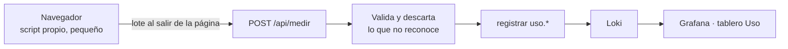

# S07 · Medición de uso

Volver a [[S00-Servidor-Inicio]]. Cómo saber qué partes del sitio se usan, cuánto tiempo y dónde se abandona, **sin vigilar a nadie**.

## La tensión, dicha de frente

Este sitio lo visitan personas que buscan ayuda psicológica. Que alguien visitó la página de ayuda por conducta suicida es, en sí mismo, un dato sensible. Las herramientas habituales de mapas de calor graban la sesión de cada persona, lo que escribe y por dónde mueve el cursor, y lo envían a un tercero. **Eso aquí no se hace.**

Lo que sí se puede hacer, y es lo que se adopta: **medición propia, anónima y agregada**. Responde las mismas preguntas de diseño sin poder reconstruir lo que hizo una persona concreta.

Esto cambia RNF-PRI-08 de [[03-Requisitos-No-Funcionales]]: de "sin analítica" a "sin analítica de terceros; medición propia anónima".

## Reglas de privacidad

| # | Regla |
|---|-------|
| 1 | **Todo se queda en el servidor propio.** Ningún dato de uso sale a otra empresa |
| 2 | **Sin cookies ni identificadores guardados.** No se reconoce a un visitante que vuelve |
| 3 | **Sin dirección de red.** No se guarda ni se usa para identificar |
| 4 | **Identificador de visita solo en memoria**, aleatorio, que muere al cerrar la pestaña. Sirve para saber que tres pasos del formulario fueron la misma visita; no para saber de quién |
| 5 | **Nunca el contenido.** Nada de lo que se escribe, ni el valor de ningún campo, ni qué servicio o psicólogo se eligió |
| 6 | **Sin grabación de sesión** ni movimiento del cursor |
| 7 | **Sin posición exacta de toques.** Se registra qué **zona** se tocó, no las coordenadas |
| 8 | **Se respeta la señal de "no rastrear"** del navegador: si está activa, no se mide nada |
| 9 | **Zonas excluidas** (lista abajo) |
| 10 | **Solo agregados en los tableros.** Ningún panel muestra visitas individuales |
| 11 | **30 días** de retención, la misma de los registros |
| 12 | **Declarado** en la política de datos, con visto bueno de la universidad (P-24) |

### Dónde no se mide, o se mide menos

| Zona | Qué se mide |
|------|-------------|
| `/ayuda-inmediata` | Solo número de visitas y de toques en "llamar", **sin identificador de visita**. Nunca qué código o línea vio una visita concreta |
| `/cita/[token]` | Solo la visita, con la ruta sin el token |
| `/crear-clave`, `/recuperar-clave`, `/ingresar` | Nada |
| Todo el panel | Nada (lo que hace el personal ya está en la auditoría) |
| Campos del formulario | Nunca el contenido; solo "se alcanzó el paso N" |

## Qué se mide

| Evento | Datos | Responde |
|--------|-------|----------|
| `uso.vista` | Ruta, tamaño de pantalla (móvil / tableta / escritorio), de dónde llegó (directo, buscador, red social, otro sitio; sin la dirección completa) | ¿Qué páginas se visitan y desde qué dispositivo? |
| `uso.permanencia` | Ruta, segundos **con la pestaña visible**, agrupados en rangos (0–10, 10–30, 30–60, 1–3 min, más de 3) | **Tiempo en pantalla** |
| `uso.desplazamiento` | Ruta, profundidad alcanzada: 25, 50, 75 o 100 % | ¿Se lee hasta el final? |
| `uso.toque` | Ruta y **zona** tocada | **Mapa de calor por zonas** |
| `uso.paso` | Paso del formulario alcanzado (1–5), y si se envió | ¿Dónde se abandona el formulario? |
| `uso.error_formulario` | Paso y nombre del campo con error (no su valor) | ¿Qué campo confunde? |
| `uso.sin_cupos` | Solo el hecho | ¿Cuánta gente no encuentra horario? |
| `uso.rendimiento` | Ruta y tiempos de carga reales | ¿Es rápido en celulares reales? |

### Zonas

Cada elemento importante lleva una marca con nombre (`data-zona="portada-pedir-cita"`). Se registra el nombre, no dónde cayó el dedo. La lista de zonas se define con el diseño de cada pantalla; unas 10 por página como máximo.

## Mapa de calor: qué se obtiene y qué no

| Se obtiene | No se obtiene |
|-----------|---------------|
| Tabla y gráfico de **qué zonas de cada página reciben más toques** | Una imagen de la página con manchas de color sobre el punto exacto de cada toque |
| Hasta dónde se desplaza la gente en cada página | Grabaciones de visitas |
| Tiempo en pantalla por página | Recorrido completo de una persona |
| Embudo del formulario paso a paso | Lo que escribió antes de abandonar |

Grafana muestra bien cuadrículas de intensidad (zona × día, página × rango de tiempo), pero **no superpone manchas sobre una captura de la página**. Para decisiones de diseño, saber que "el botón de la portada recibe el 60 % de los toques y el del pie el 2 %" suele ser más útil que la mancha.

Si más adelante se quiere la imagen superpuesta, la vía compatible con estas reglas es añadir al evento de toque una posición **redondeada a una cuadrícula** dentro de la zona y dibujarla con una página propia. Las herramientas externas de mapas de calor quedan descartadas mientras graben sesiones o envíen datos a terceros.

## Cómo funciona

| Aspecto | Norma |
|---------|-------|
| Script | Propio, de menos de 2 KB, cargado después del contenido; si falla, el sitio no se entera |
| Envío | En lote, al ocultarse la página, con el mecanismo del navegador que no bloquea la navegación |
| Ruta | `POST /api/medir`: acepta solo los eventos y campos de la tabla; todo lo demás se descarta |
| Límite | 60 eventos por minuto por visita; lote de máximo 30 |
| Almacenamiento | **No toca la base de datos**: se escribe como registro y va a Loki |
| Rutas | Siempre normalizadas: `/eventos/[slug]`, `/cita/[token]` |
| Robots | Se descartan los agentes de usuario de robots conocidos |
| Interruptor | `MEDICION=no` la apaga por completo |

## Tablero "Uso"

| Panel | Muestra |
|-------|---------|
| Visitas por día y por página | Tendencia |
| Dispositivos | Móvil / tableta / escritorio |
| De dónde llegan | Directo, buscador, redes, otro sitio |
| Tiempo en pantalla por página | Distribución por rangos |
| Profundidad de lectura por página | Cuántos llegan al 50 % y al 100 % |
| **Zonas más tocadas por página** | Cuadrícula de intensidad |
| **Embudo del formulario** | Cuántos llegan a cada paso y cuántos envían |
| Campos con más errores | Cuál confunde |
| Búsquedas sin cupo | Por semana |
| Uso de la ayuda inmediata | Visitas y toques en "llamar", solo totales |
| Velocidad real | Tiempo de carga en celulares |

## Para qué se usa

Para decidir cambios de diseño con datos: si la mitad abandona en el paso 4, sobran campos; si nadie llega al final de "Cómo funciona", es muy larga; si muchas búsquedas terminan sin cupo, faltan horarios. **No** se usa para evaluar a psicólogos ni para contactar a nadie.

Se revisa una vez al mes ([[S08-Mantenimiento]]) y los hallazgos se llevan al CAPL.
