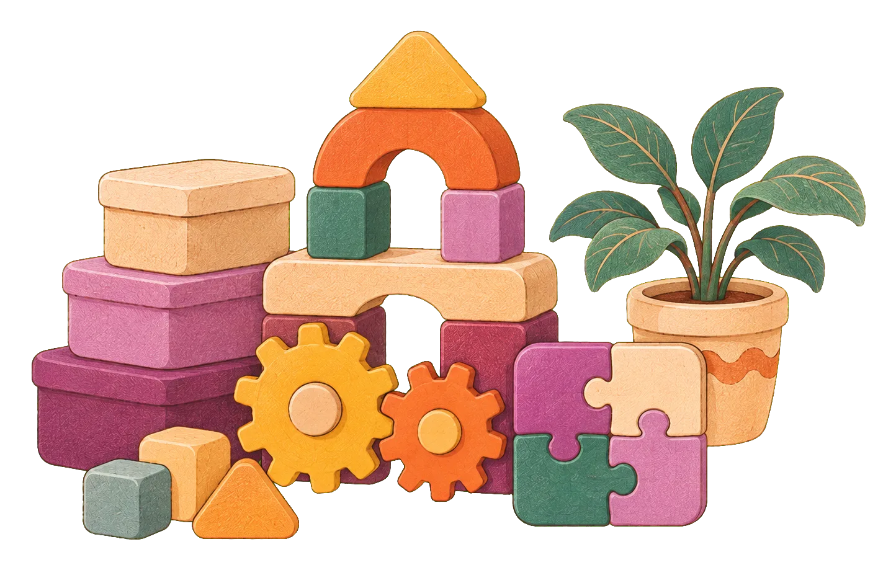
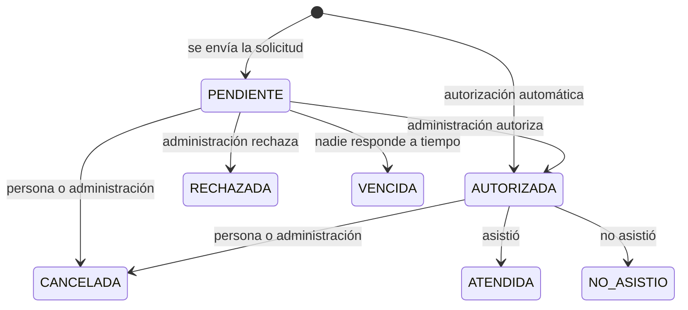

← [README](../README.md) · [Anterior: Capacidades](capacidades.md) · [Siguiente: Seguridad](seguridad.md)

# Arquitectura

<p align="center"></p>

## Stack

| Capa       | Elección                                                                                                       |
| ---------- | -------------------------------------------------------------------------------------------------------------- |
| Aplicación | Next.js 16 (App Router) y React 19, con TypeScript. Tiene cambios incompatibles: ver [AGENTS.md](../AGENTS.md) |
| Estilos    | Tailwind CSS 4 solo con tokens propios, fuente Nunito                                                          |
| Datos      | PostgreSQL con Prisma 7                                                                                        |
| Sesiones   | Propias, en cookie firmada con HMAC-SHA256 (sin Auth.js)                                                       |
| Validación | Zod, mismos esquemas en navegador y servidor                                                                   |
| Correo     | Resend, plantillas en HTML y texto                                                                             |
| Pruebas    | Vitest y Playwright                                                                                            |
| Entrega    | Node 24, Docker, Caddy y GitHub Actions                                                                        |

## Carpetas

```
app/          páginas y rutas: (publico), (acceso), (panel), api
componentes/  átomos, moléculas, organismos y piezas de panel y público
servidor/     reglas de negocio: citas, cuentas, correo, tareas, permisos
contratos/    esquemas Zod compartidos
correos/      plantillas de correo
contenido/    textos, emergencias, ilustraciones y marca
prisma/       esquema, migraciones y semillas
estilos/      tokens de diseño
infra/        Docker, proxy, respaldos y tareas
e2e/          pruebas de extremo a extremo
cerebro/      requisitos, especificación y normas
```

## Modelo de datos

| Grupo               | Tablas                                                     |
| ------------------- | ---------------------------------------------------------- |
| Personas del centro | `Usuario`, `PerfilPsicologo`, `Disponibilidad`, `Bloqueo`  |
| Atención            | `Servicio`, `Cita`, `Configuracion`                        |
| Eventos             | `Evento`, `Inscripcion` (sin formulario público)           |
| Acceso              | `TokenAcceso`, `CodigoAcceso`, `DispositivoConfiable`      |
| Sistema             | `Auditoria`, `Trabajo` (cola), `CorreoSuprimido`, `Sondeo` |

Una restricción de la base de datos impide que dos citas activas del mismo psicólogo se crucen. Los cupos no se guardan: se calculan al consultar.

## Estados de la cita



Reprogramar no es un estado: cancela la cita y crea otra en la misma transacción.

## Cola de correos

El hecho (por ejemplo, autorizar) y su correo se guardan en la misma transacción, en `Trabajo`. Se intenta enviar al momento; si falla, la tarea de cada minuto reintenta con esperas crecientes (1 min, 5 min, 30 min, 2 h, 12 h). El código de ingreso no usa la cola.

Fuente detallada: [Arquitectura](../cerebro/05-Arquitectura.md) · [Modelo de datos](../cerebro/especificacion/E02-Modelo-de-Datos.md) · [Colas y tareas](../cerebro/servidor/S05-Colas-y-Tareas.md) · [`schema.prisma`](../prisma/schema.prisma)
