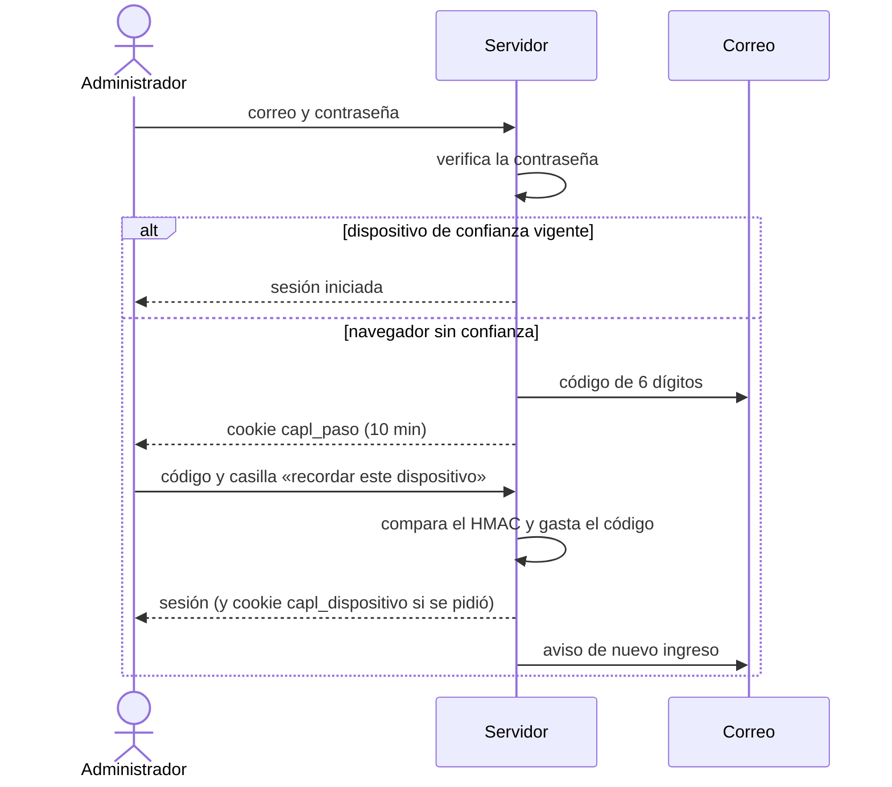

← [README](../README.md) · [Anterior: Seguridad](seguridad.md) · [Siguiente: Correos](correos.md)

# Segundo paso de ingreso (2FA)

<p align="center"></p>

Es obligatorio para `ADMIN` y **no aplica** a `PSICOLOGO`. Consiste en un código de 6 dígitos enviado al correo de la cuenta.

## Flujo



## Reglas

| Regla                    | Valor                                                                       |
| ------------------------ | --------------------------------------------------------------------------- |
| Vigencia del código      | 10 minutos                                                                  |
| Usos                     | Uno; pedir otro anula el anterior                                           |
| Intentos                 | 5 por código                                                                |
| Reenvío                  | Tras 60 segundos y máximo 3 por hora                                        |
| Dispositivo de confianza | 30 días en ese navegador, solo si se marca la casilla                       |
| Se vuelve a pedir        | Navegador nuevo, plazo vencido, contraseña cambiada o sesiones cerradas     |
| Qué se guarda            | HMAC del código y hash del identificador del dispositivo, nunca los valores |
| Aviso                    | Correo con fecha, hora y navegador tras cada ingreso que necesitó código    |

| Cookie             | Contiene                                             | Duración   |
| ------------------ | ---------------------------------------------------- | ---------- |
| `capl_paso`        | Prueba firmada de que la contraseña ya se verificó   | 10 minutos |
| `capl_dispositivo` | Identificador aleatorio del dispositivo de confianza | 30 días    |

## Casos particulares

- Crear la contraseña desde un enlace de invitación o recuperación abre sesión directamente: el enlace ya demuestra el control del correo.
- Si el correo del código no sale, la pantalla permite reenviarlo.
- En local, con `CORREO_MODO=consola` y `CORREO_BUZON_LOCAL`, el código queda en un archivo de texto del buzón. Ver [Instalación](instalacion-y-entornos.md).

## Acceso de emergencia

Si ningún administrador puede entrar, quien opera el servidor ejecuta allí mismo:

```bash
npm run admin:crear -- --correo persona@dominio --nombre "Nombre"
```

Crea la cuenta, envía su enlace, lo deja en la auditoría y avisa a los demás administradores.

Código: [`segundoPaso.ts`](../servidor/cuentas/segundoPaso.ts) · Norma: [S02 · Acceso y permisos](../cerebro/servidor/S02-Acceso-y-Permisos.md)
