← [README](../README.md) · [Anterior: Segundo paso (2FA)](autenticacion-2fa.md) · [Siguiente: Instalación y entornos](instalacion-y-entornos.md)

# Correos

Las plantillas viven en [`correos/`](../correos) y tienen versión HTML y de texto. Casi todas comparten [`base.ts`](../correos/base.ts). Las vistas usan los datos de ejemplo de cada archivo. «Administración» es el correo configurado para recibir avisos.

`npm run correos` genera el HTML y el texto de todas en `datos/archivos/vista-previa-correos/`, sin enviar nada.

## Citas

| Plantilla                  | Cuándo se envía                                   | Destinatario      | Vista previa                                                                                                                                                    |
| -------------------------- | ------------------------------------------------- | ----------------- | --------------------------------------------------------------------------------------------------------------------------------------------------------------- |
| `solicitud-recibida`       | Se crea una cita pendiente                        | Solicitante       | <a href="img/correos/solicitud-recibida.png">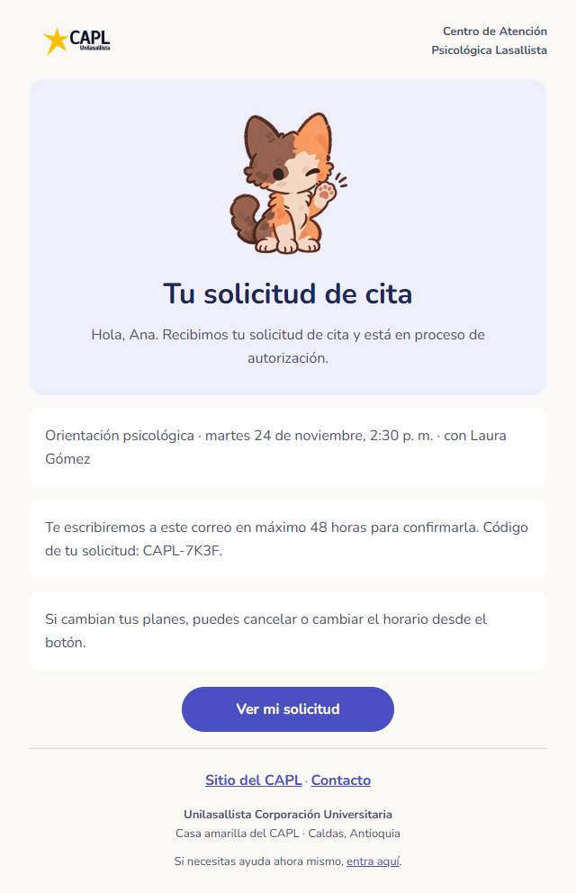</a>                   |
| `nueva-solicitud`          | Se crea una cita pendiente                        | Administración    | <a href="img/correos/nueva-solicitud.png">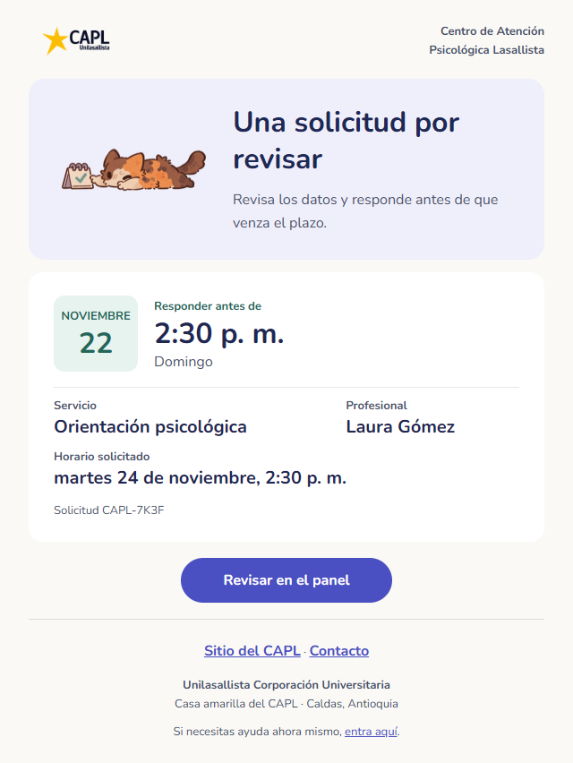</a>                            |
| `cita-autorizada`          | La cita queda autorizada                          | Solicitante       | <a href="img/correos/cita-autorizada.png">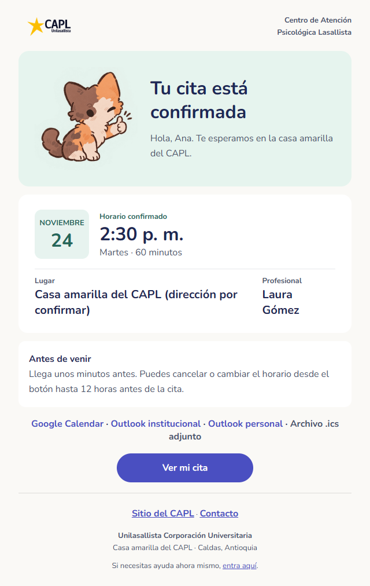</a>                            |
| `cita-no-autorizada`       | La cita se rechaza                                | Solicitante       | <a href="img/correos/cita-no-autorizada.png">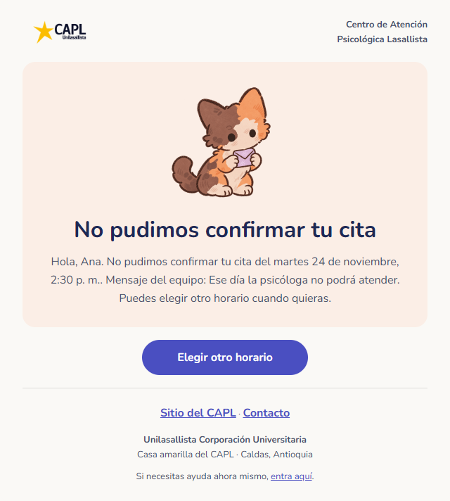</a>                   |
| `cita-vencida`             | La solicitud vence sin respuesta                  | Solicitante       | <a href="img/correos/cita-vencida.png">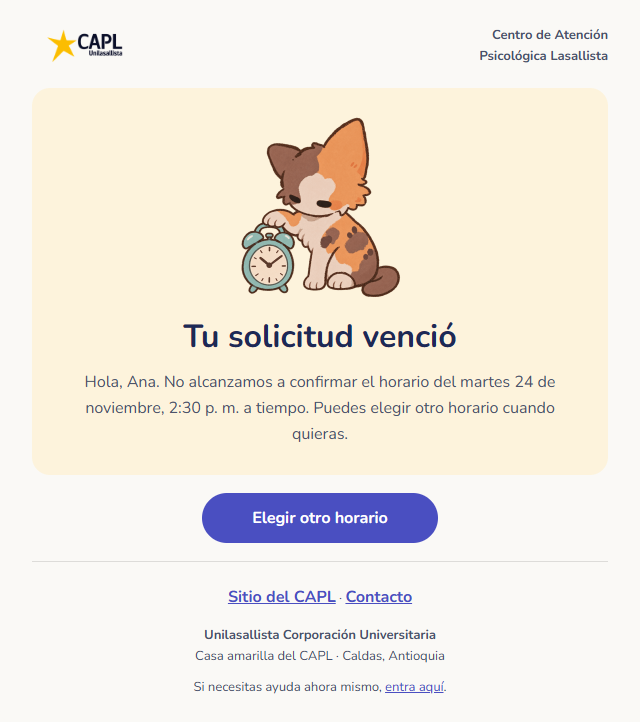</a>                                     |
| `cita-cancelada`           | La cita se cancela                                | Solicitante       | <a href="img/correos/cita-cancelada.png">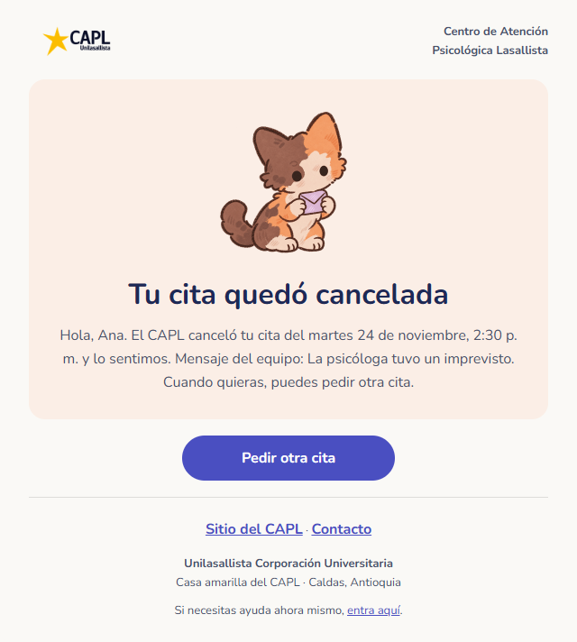</a>                               |
| `cita-reasignada`          | Administración cambia el horario o el profesional | Solicitante       | <a href="img/correos/cita-reasignada.png">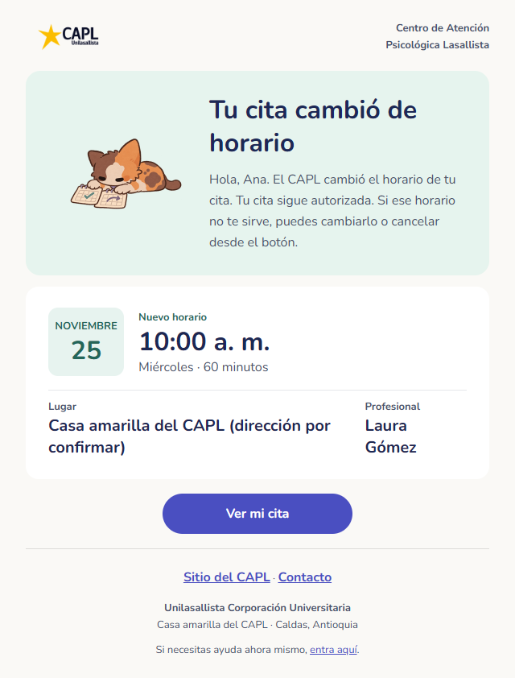</a>                            |
| `recordatorio`             | Unas 24 horas antes                               | Solicitante       | <a href="img/correos/recordatorio.png">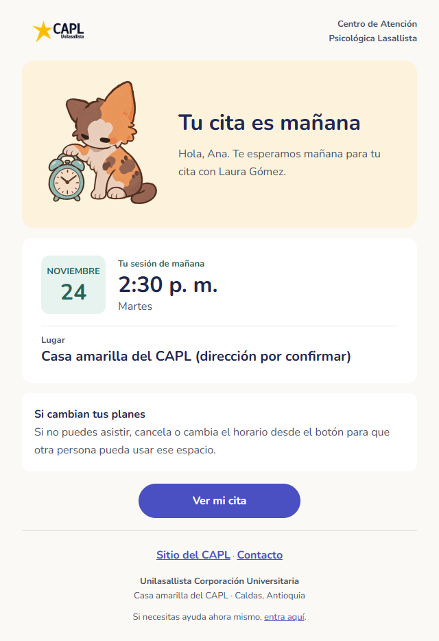</a>                                     |
| `enlace-cita`              | Alguien consulta la cita con su código            | Correo de la cita | <a href="img/correos/enlace-cita.png">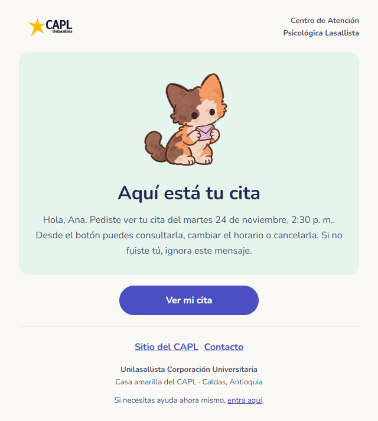</a>                                        |
| `cita-nueva-psicologo`     | Se autoriza una cita                              | Psicólogo         | <a href="img/correos/cita-nueva-psicologo.png">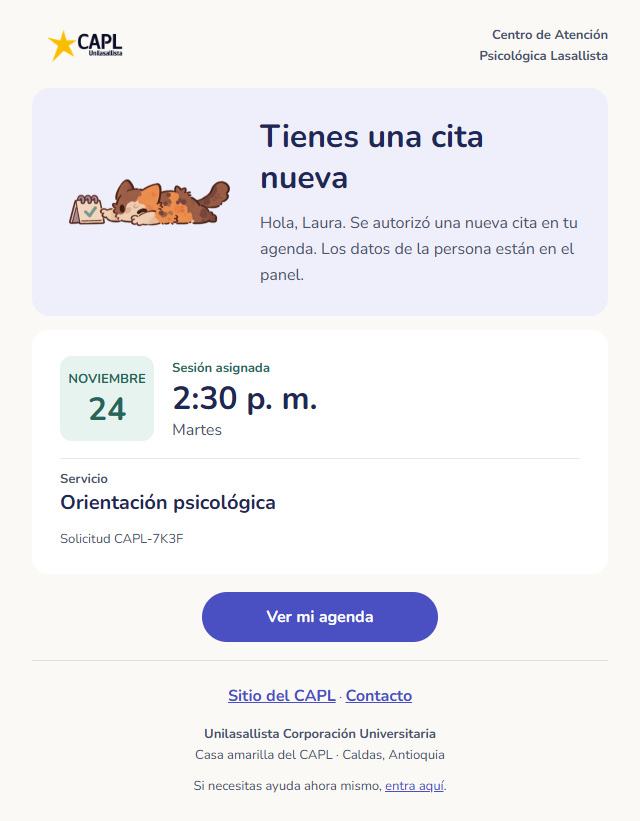</a>             |
| `cita-cancelada-psicologo` | Se cancela una cita autorizada                    | Psicólogo         | <a href="img/correos/cita-cancelada-psicologo.png">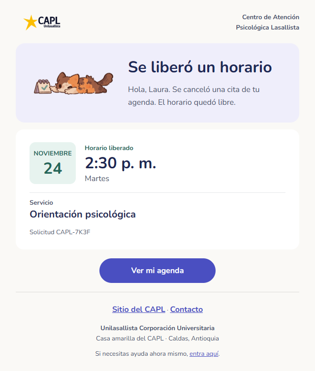</a> |

## Cuentas y seguridad

| Plantilla                 | Cuándo se envía                                        | Destinatario              | Vista previa                                                                                                                                                 |
| ------------------------- | ------------------------------------------------------ | ------------------------- | ------------------------------------------------------------------------------------------------------------------------------------------------------------ |
| `invitacion`              | Se crea una cuenta o se reenvía la invitación          | Psicólogo o administrador | <a href="img/correos/invitacion.png">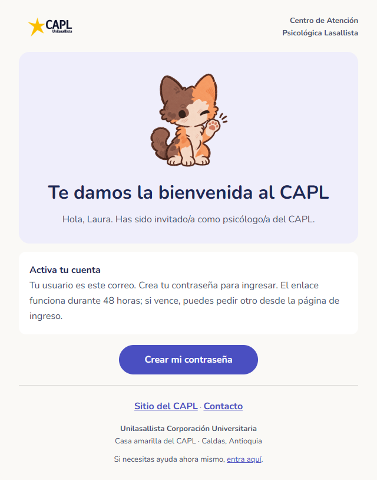</a>                                        |
| `recuperar-clave`         | Se pide una contraseña nueva                           | Titular de la cuenta      | <a href="img/correos/recuperar-clave.png">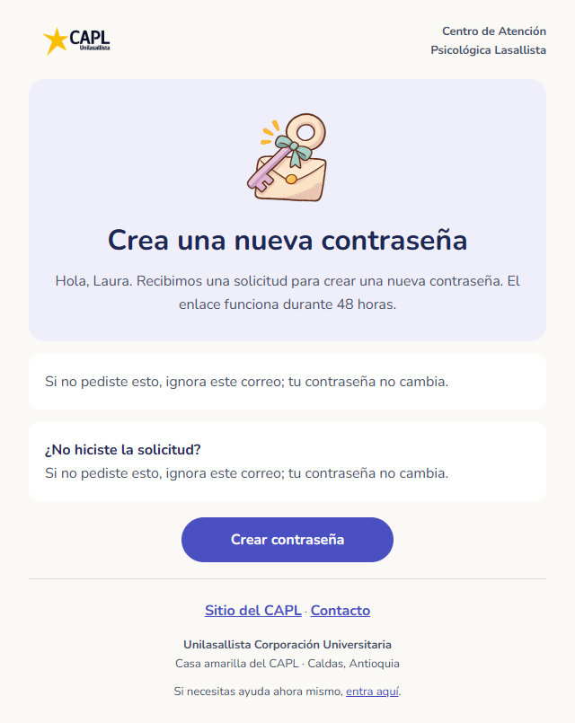</a>                         |
| `codigo-ingreso`          | Ingreso desde un navegador sin confianza               | Administrador             | <a href="img/correos/codigo-ingreso.png">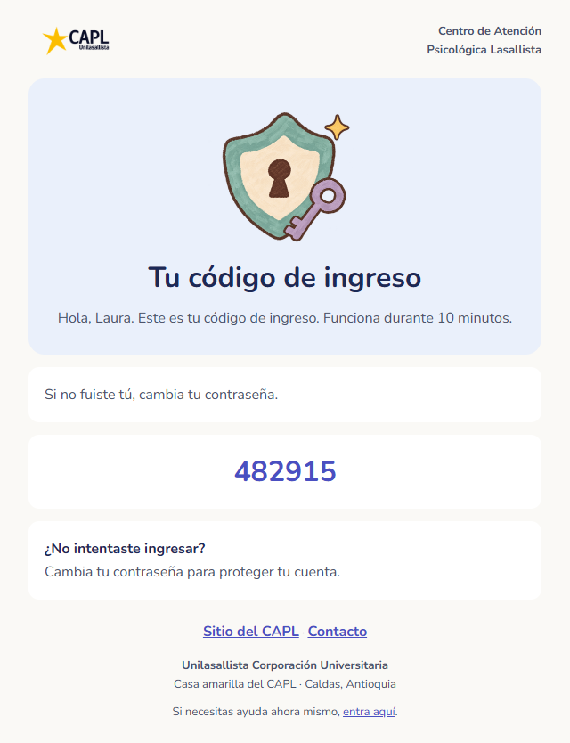</a>                            |
| `aviso-ingreso`           | Se verifica un código de ingreso                       | Administrador             | <a href="img/correos/aviso-ingreso.png">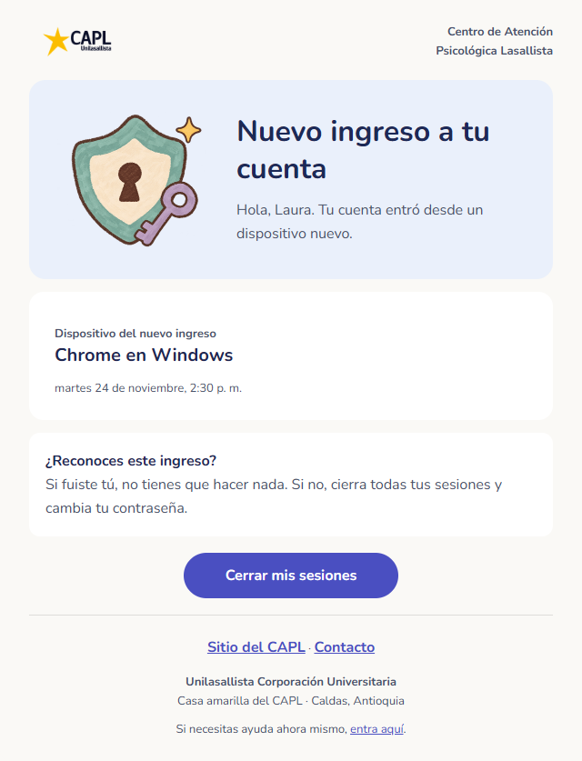</a>                               |
| `aviso-acceso-emergencia` | Se crea un administrador desde la consola del servidor | Demás administradores     | <a href="img/correos/aviso-acceso-emergencia.png">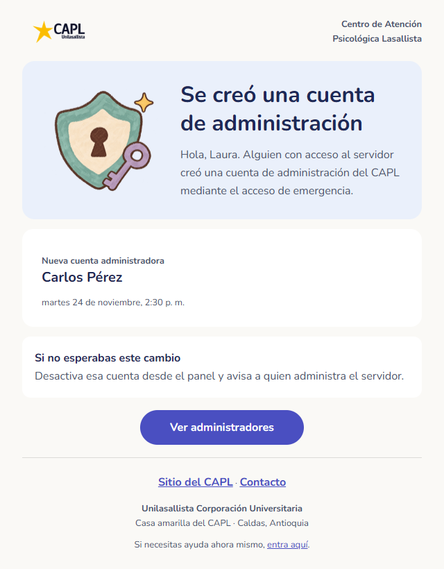</a> |

## Informe y eventos

| Plantilla            | Cuándo se envía                               | Destinatario   | Vista previa                                                                                                                                  |
| -------------------- | --------------------------------------------- | -------------- | --------------------------------------------------------------------------------------------------------------------------------------------- |
| `estado-servidor`    | Una vez al día, desde las 8:00 (Bogotá)       | Administración | <a href="img/correos/estado-servidor.png">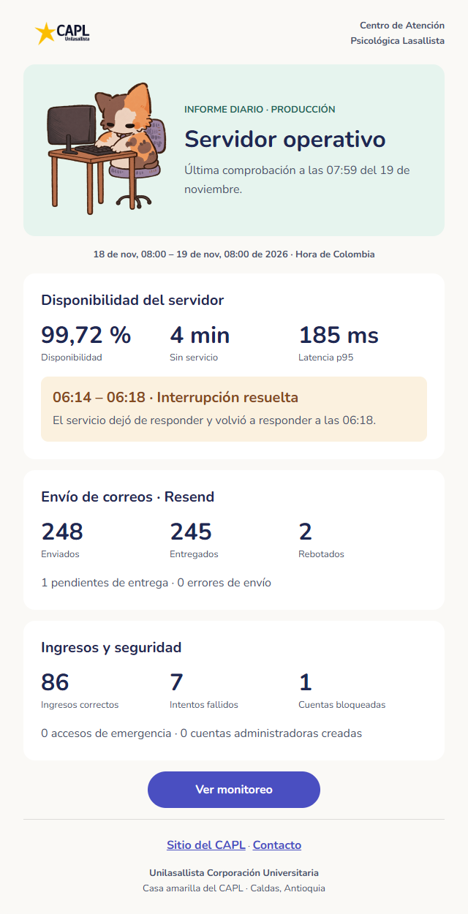</a>          |
| `inscripcion-evento` | Sin uso: la inscripción a eventos se descartó | Inscrito       | <a href="img/correos/inscripcion-evento.png">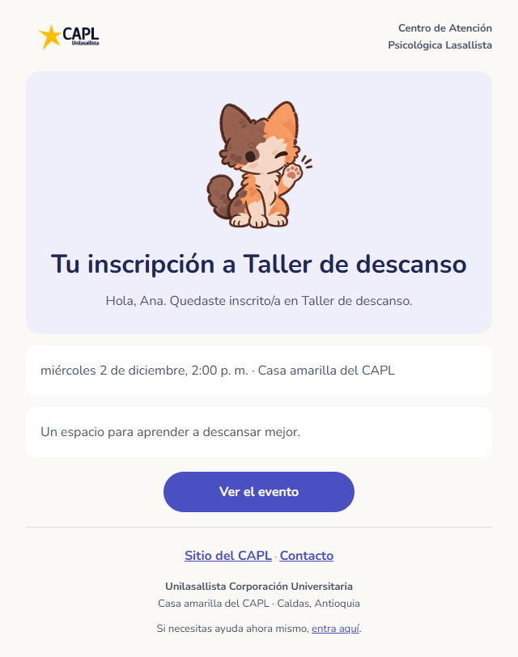</a> |

En el entorno de pruebas los envíos se redirigen al equipo (`CORREO_REDIRIGIR_A`).

Fuente detallada: [E06 · Correos](../cerebro/especificacion/E06-Correos.md) · [Lista de entrega](../cerebro/operacion/lista-entrega-correos.md)
